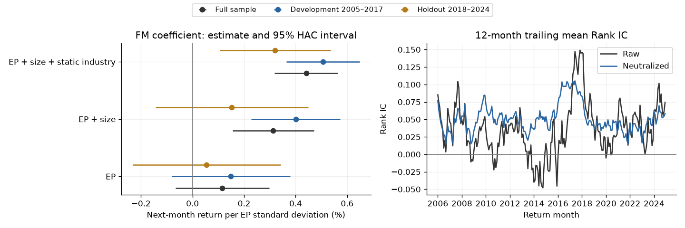

# Robustness of Value Signals and Asset-Pricing Models in China A-Shares

A reproducible empirical study of **how robust the evidence for A-share value signals is**, from data measurement to return prediction and model pricing. EP is the main case, with five other characteristics providing a fixed comparison set. **It does not claim a deployable alpha strategy or a new asset-pricing model.**

## Research thread

1. **Establish a credible measurement base.** Build one announcement-aware monthly panel, correct returns and signal timing, and disclose historical coverage and missing labels. This is the foundation, not a separate prediction project.
2. **Test whether the signal evidence survives scrutiny.** For EP and the six-signal comparison set, distinguish Rank IC, conditional FM slopes and gross portfolio spreads. Apply dependence-aware inference, multiple-testing correction, block-length sensitivity and a retrospective chronological split. EP illustrates why a significant controlled slope need not imply a convincing raw spread; the other signals test how broadly that pattern holds.
3. **Examine the complementary pricing question.** Compare CAPM and adapted FF3/FF5 on the same 25 size–value portfolios. This asks how model-dependent the pricing of size–value exposures is, not whether the models explain the six signal spreads: those spreads are not the GRS test assets.

The conclusion is about **the limits and model dependence of value evidence**, not choosing a winning signal or declaring FF5 the best model. The final-snapshot liquidity analysis and CAPM beta exercise are supporting diagnostics, not additional research claims.

## Findings from the executed study

- **Data:** 2005–2024, 5,647 observed securities including 310 delisted names; 623,062 eligible stock-months with observed next-month returns. Adjustment changes 26,235 monthly returns by more than one percentage point. Missing forward labels: 401.
- **Inference depends on controls:** over 239 usable EP months, HAC t statistics are 1.25 for EP only, 3.90 after size control, and 7.04 after size plus static industry control. Conditional regression evidence is distinct from portfolio profitability.
- **Raw EP spread remains weak:** gross annualized mean 5.22% (12 × monthly mean), Sharpe 0.32, HAC p=0.072, and six-signal BH q=0.108. Its 10,000-resample seven-month-block Sharpe interval is [-0.03, 0.68], including zero.
- **Chronological holdout:** the 2018–2024 EP spread has HAC p=0.336. In this period, EP + size has p=0.312, while adding static industry controls yields p=0.0035. The static industry caveat materially affects interpretation.
- **Six-signal extension:** all six signals receive FM regressions and 10,000-resample block Bootstrap at four block lengths in three periods. At seven-month blocks, full-sample pointwise Sharpe intervals are above zero for Size, Value and LowVol; only Size and LowVol remain above zero in the retrospective holdout. Profitability has 29 internal missing months, preserved inside calendar blocks rather than silently removed.
- **Model comparison is mixed:** on 25 value-weighted test portfolios and 174 common months (2010-07–2024-12), GRS p values are 0.044 (CAPM), 0.120 (adapted FF3), and 0.088 (adapted FF5). FF5 has slightly smaller mean absolute alpha but a larger GRS statistic than FF3; it does not uniformly dominate.

The holdout is retrospective, not untouched prospective evidence. All long–short results are gross academic spreads; borrowing, trading costs, impact, price limits, and delisting liquidation proceeds are not modeled.



## Reproduce

Python 3.11 was used. Raw data are not distributed; see [required local schemas](docs/data.md).

```powershell
python -m venv .venv
.\.venv\Scripts\python.exe -m pip install -r requirements.txt
.\.venv\Scripts\python.exe -m unittest discover -s tests -v
.\.venv\Scripts\python.exe run_research.py --data-dir 'PATH_TO_LICENSED_PARQUET_DIRECTORY'
```

`run_research.py` executes and saves the single integrated notebook top-to-bottom. Intermediate security-level panels are written to ignored `.local/`; shareable aggregate tables go to `results/` and PNGs to `figures/`. A run is successful only when the process exits zero and `results/execution.json` reports `passed`. The checked-in notebook contains its executed tables and figures. Typical execution on the author's machine is on the order of minutes, not a performance guarantee.

## Read the research

Open the [complete research notebook](notebooks/ashare_value_signal_robustness.ipynb). It follows one continuous workflow with three chapters: data integrity and investable universe, value-signal robustness, and asset-pricing model comparison. Setup and panel construction run once; later chapters use those results directly.

[Methodology and correction record](docs/methodology.md) explains timing, historical ST, announcement-aware report versions, the six-signal test family, calendar-aware HAC, and adapted factor definitions. [Research findings](docs/findings.md) provides a compact interpretation.

## Validation and scope

Twelve small regression tests cover split adjustment, missing-calendar gaps, momentum timing, future report revisions, ambiguous reports, forward portfolio sorting, future missingness, historical ST, calendar-aware HAC, GRS normalization, six-signal FM agreement with independent OLS, and calendar-preserving Bootstrap. GitHub Actions runs these tests without vendor data; it does **not** reproduce the empirical study. Full-study execution is verified locally with the licensed inputs.

Standard asset-pricing/statistical methods are attributed in the methodology; no novel factor or causal identification is claimed. Only research code, aggregate results and figures are published; licensed raw data remain local.
