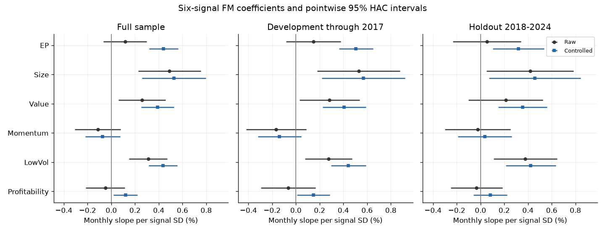
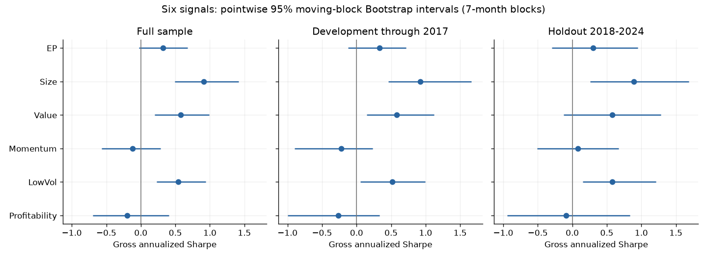

# Executed findings

The central question is how robust A-share value evidence remains after correcting measurement and changing the inferential lens. EP is the focal example, the six-signal family supplies comparison evidence, and the model-pricing section addresses a related but distinct question on size–value portfolios. The data audit underpins all three; it is not a separate investment result.

## Value signals: three different questions

| Question | Observed result | Interpretation |
|---|---|---|
| Does raw EP rank stocks by next-month returns? | Mean Rank IC 0.0366; HAC t=4.31 | Positive rank association, not a strategy Sharpe or causal effect |
| Is the EP regression slope conditional on exposures nonzero? | EP-only t=1.25; size-controlled t=3.90; size/static-industry-controlled t=7.04 | Strong dependence on the conditioning model |
| Is a simple high-minus-low EP portfolio convincing? | Gross Sharpe 0.32; HAC p=0.072; BH q=0.108; seven-month-block Sharpe CI [-0.03, 0.68] | Not significant at 5%; the interval includes zero |

These questions are not contradictory: they measure different estimands and use different weighting/control choices. A conditional slope must not be advertised as an annualized portfolio return.

## Chronological stability

The EP spread has gross Sharpe 0.30 and HAC p=0.336 in 2018–2024. Size-controlled EP loses 5% significance in this period (p=0.312), while the specification with static industry controls remains significant (p=0.0035). Therefore, a blanket claim of robust value alpha is unsupported. The static industry classification and retrospective split must accompany this result.

Within the six-signal **portfolio-spread** family, size, inverse-PB value, and low total volatility survive full-sample BH correction at 5%. In the chronological holdout, only size survives the same six-test correction. This is a period-specific result, not selection of a deployable strategy. Exact p values and sample counts are in [signal_inference.csv](../results/signal_inference.csv).

## Six-signal FM and Bootstrap extension

Each signal now has FM regressions, raw/neutralized IC inference, and 10,000-resample Bootstrap at four block lengths in three periods. The table shows direction-aligned raw FM slopes (BH correction across six tests per period) and **pointwise** 95% gross-Sharpe intervals at seven-month blocks:

| Signal | Full raw-FM BH q | Holdout raw-FM BH q | Full Sharpe interval | Holdout Sharpe interval |
|---|---:|---:|---|---|
| EP | 0.299 | 0.861 | [-0.03, 0.68] | [-0.29, 0.95] |
| Size | 0.00082 | 0.075 | [0.49, 1.42] | [0.26, 1.69] |
| Value | 0.021 | 0.369 | [0.20, 0.99] | [-0.12, 1.28] |
| Momentum | 0.299 | 0.861 | [-0.57, 0.28] | [-0.51, 0.67] |
| LowVol | 0.00082 | 0.033 | [0.23, 0.94] | [0.15, 1.21] |
| Profitability | 0.545 | 0.861 | [-0.70, 0.40] | [-0.94, 0.84] |

Only LowVol's raw FM slope survives BH correction in the holdout. With static industry and size controls (industry only for Size), EP, Size, Value and LowVol survive the corresponding holdout family correction. Thus the regression specification changes the conclusion; no control set establishes causal effects.

At seven-month blocks, Size and LowVol have positive holdout Sharpe intervals. These intervals are not multiple-testing-adjusted, which explains why they must not be equated with the portfolio BH decision. All 72 Bootstrap settings remain in [signal_bootstrap.csv](../results/signal_bootstrap.csv); full FM results are in [fm_inference.csv](../results/fm_inference.csv). Signal start dates differ. Profitability has 160 observed months and 29 internal missing months in its full window; blocks retain missing calendar positions rather than joining distant months. Missingness may be informative and remains a limitation.

## Model pricing

The signal results do not settle how well asset-pricing models describe size–value portfolio returns. The following comparison therefore uses a new estimand: joint pricing errors on 25 common test portfolios, rather than FM characteristic slopes or the six long–short spreads. It does not attribute the EP spread to FF3/FF5 exposures.

CAPM is rejected at 5% on the common sample (GRS p=0.0443), but the margin is modest and the conventional GRS reference assumptions matter. Adapted FF3 (p=0.1197) and FF5 (p=0.0880) are not rejected at 5%. Their mean absolute monthly alphas are 0.161% and 0.148%, respectively, versus 0.347% for CAPM. FF5's slightly lower mean error does not translate into a lower joint GRS statistic. Nonrejection does not validate the model, and cross-model p-value comparisons do not test a nested improvement.

## Data correction mattered

The adjusted/raw return discrepancy exceeds one percentage point in 26,235 stock-months. Historical names identify 25,688 ST stock-months. The report-version checks identify 6 conflicting income report dates and 5 conflicting balance-sheet report dates; ambiguous versions are not arbitrarily selected. The supplied data observe 310 delisted securities, but this alone does not establish complete survivorship-free coverage.

## Overall answer

Corrected data support some conditional value associations, but not a blanket claim of robust value alpha: EP's raw spread remains weak, and conclusions across the comparison signals depend on controls, test families and periods. On the complementary size–value pricing question, smaller average FF5 pricing errors do not imply uniformly better joint pricing performance than FF3. Together these results show why prediction, conditional association and model pricing must be reported separately. They are not evidence of net executable returns.
