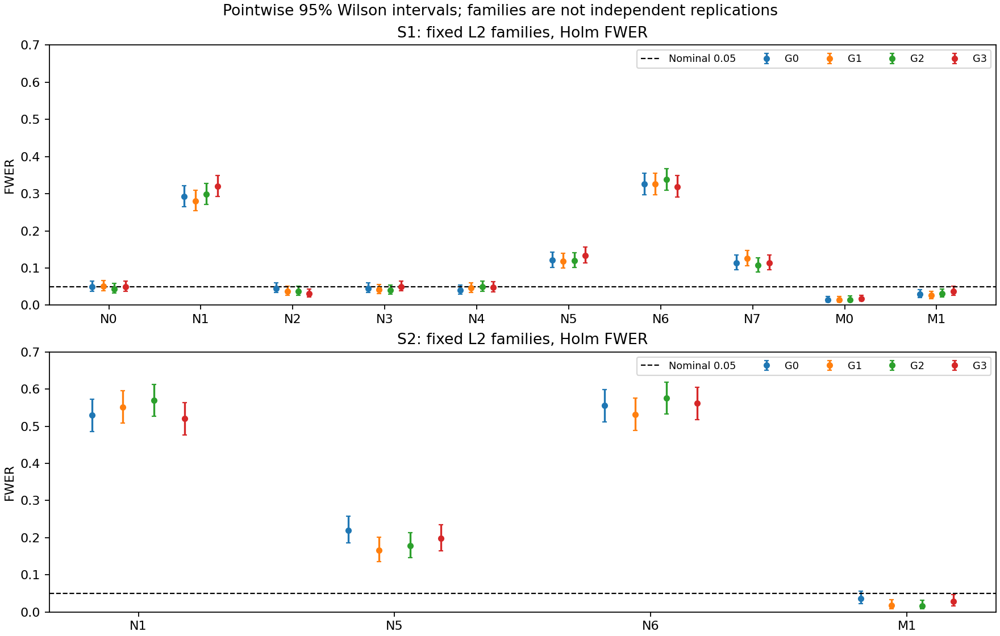
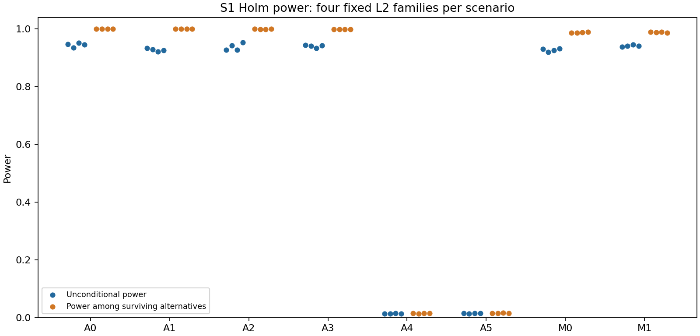

# 第一阶段最终校准报告

**执行已完整结束；部分预定压力机制下，主方法的名义5%错误控制未通过校准。** 这不是未完成任务，也不允许据此更换主发现规则或删除不利机制。

## 完成范围与解释单位

|批次|完整面板|每机制重复|L2/全局家族规模|用途|
|---|---:|---:|---|---|
|S0|80/80|5|6 / 12|工程冒烟，不作有精度的误差率判断|
|S1|16,000/16,000|1,000|45 / 180|16种机制主校准|
|S2|2,000/2,000|500|435 / 1,740|N1、N5、N6、M1规模压力|

共18,080份指标检查点和18,080份配对表。所有机制、重复编号及固定家族指标完整；S2于北京时间2026-10-19 14:25:30结束。迁移后的2,000份结果现统一保存在本机，远端计算仍停止。
下表范围是四个固定L2家族估计值的最小—最大值，不是置信区间。每个家族的Wilson区间跨独立面板计算；不把同一面板的相关家族合并为独立试验。区间也不具有跨机制同时覆盖保证。

## 主方法：固定L2的Holm结果

|批次|机制|FWER范围|无条件功效范围|触发主警报的家族数|
|---|---|---:|---:|---:|
|S1|N0|4.40%–5.10%|NA|0/4|
|S1|N1|28.10%–32.00%|NA|4/4|
|S1|N2|3.10%–4.50%|NA|0/4|
|S1|N3|4.00%–5.00%|NA|0/4|
|S1|N4|4.00%–4.90%|NA|0/4|
|S1|N5|11.80%–13.40%|NA|4/4|
|S1|N6|31.90%–33.80%|NA|4/4|
|S1|N7|10.70%–12.60%|NA|4/4|
|S1|A0|0.00%–0.00%|93.55%–95.26%|0/4|
|S1|A1|0.00%–0.00%|92.22%–93.36%|0/4|
|S1|A2|0.00%–0.00%|92.77%–95.43%|0/4|
|S1|A3|0.00%–0.00%|93.32%–94.50%|0/4|
|S1|A4|0.00%–0.00%|1.28%–1.44%|0/4|
|S1|A5|0.00%–0.00%|1.39%–1.52%|0/4|
|S1|M0|1.40%–1.70%|92.00%–93.26%|0/4|
|S1|M1|2.60%–3.70%|93.79%–94.56%|0/4|
|S2|N1|52.00%–57.00%|NA|4/4|
|S2|N5|16.60%–22.00%|NA|4/4|
|S2|N6|53.20%–57.60%|NA|4/4|
|S2|M1|1.60%–3.60%|85.53%–87.43%|0/4|

N1保留非零的独立特有随机趋势，虽然共同趋势占比很高，仍为全零假设机制。N5为后半样本波动上升，N6为前四分之一后波动下降，N7叠加序列相关、厚尾和波动上升。后面三类压力的具体条件应分别说明，不能泛称“任何异方差都会使EG失效”。
S1的N1、N5、N6、N7均为4/4家族触发警报；S2的N1、N5、N6均为4/4。S2三者FWER分别为52.0%–57.0%、16.6%–22.0%、53.2%–57.6%。这是这些人工机制中的错误事件频率，不是市场110对发现的假阳性比例，也不是漏做GLOBAL校正。
A0–A5为全真机制，因此FWER为0是其真值结构决定的，不能用来证明错误控制。φ=.99的A4/A5无条件功效只有约1.3%–1.5%，即使在通过预检的真备择中也很低；这表明该设定下检测慢回复关系困难，而不是无协整。

## 功效、预检与方法增量

主功效以全部真备择为分母，包含预检排除项；条件功效只描述存活真备择。S1中A0–A3每家族45个真备择平均约2.1–3.5个被预检排除，存活真备择条件功效接近1；A4/A5的低功效并不能仅归因于预检。没有对预检失败对进行反事实EG重算，故排除比例或条件/无条件差异不等于已测量的因果功效损失。

|批次/混合机制|方法|FDR范围|无条件功效范围|
|---|---|---:|---:|
|S1/M0|BF|0.19%–0.36%|91.78%–92.90%|
|S1/M0|Holm|0.28%–0.44%|92.00%–93.26%|
|S1/M0|BH|2.66%–3.34%|93.08%–94.18%|
|S1/M1|BF|0.46%–0.81%|93.45%–94.18%|
|S1/M1|Holm|0.54%–1.10%|93.79%–94.56%|
|S1/M1|BH|4.34%–5.38%|94.66%–95.47%|
|S2/M1|BF|0.03%–0.19%|83.50%–85.22%|
|S2/M1|Holm|0.03%–0.26%|85.53%–87.43%|
|S2/M1|BH|3.89%–5.32%|94.01%–95.51%|

BH在真假混合机制中的FWER超过5%不能直接判定其FDR控制失败。以上FDR点估计和完整CSV中的MCSE要一起阅读；略高于5%的点估计本身不等于经不确定性判定的失准。BF核心、Holm相对BF增量、BH相对Holm增量的真/假组成，已按固定家族与每个独立面板重新汇总到[increment_and_gate_diagnostics.csv](simulation/increment_and_gate_diagnostics.csv)。

## 局部并集与GLOBAL对照

|批次/机制|任意L2家族发生假发现（Holm）|GLOBAL-Holm FWER|
|---|---:|---:|
|S1/N0|17.70%|5.90%|
|S1/N1|75.30%|48.30%|
|S1/N5|40.80%|15.70%|
|S1/N6|77.30%|53.70%|
|S1/N7|39.20%|15.00%|
|S1/M1|11.90%|4.90%|
|S2/N1|95.40%|77.20%|
|S2/N5|57.00%|29.00%|
|S2/N6|96.80%|83.00%|
|S2/M1|9.40%|2.60%|

局部家族并集不是单个L2的5%控制目标；GLOBAL使用独立的全局校正。即使GLOBAL也不能修复失准的单项p值。市场主清单仍采用预先固定的L2-Holm规则，不能事后改用GLOBAL来筛选。

## 数值、实现排查与可复现性

- 全18,080面板的已记录数值不可用计数与有限尾部零计数均为0；其余逐对诊断及警告字段保留在完整配对表。这不等于所有统计模型条件成立。
- 对新增警报S1/N5、N6、N7及S2/N1、N5、N6，各取首个包含有效错误Holm拒绝的面板之首个配对，按原种子重新生成输入并调用真实coint，六例统计量和p值均与存档一致。旧S1/N1另有三例记录。抽查未发现实现差异，不是对全部代码路径或有限样本p值有效性的证明。
- 修正了汇总层的二元指标MCSE：按计划使用sqrt[r(1−r)/B]；FDP、功效等仍用重复级样本标准差/sqrt(B)。旧实现对二元指标也用了ddof=1。所有FWER/FDR/功效点估计、Wilson区间、主警报与市场发现均未改变；只刷新汇总标准误。零事件的插件MCSE可为0，必须结合非退化Wilson上限，不能称无误差。
- Windows/Linux环境此前完成锁定依赖及合成一致性核对；本次不重跑全部市场EG或Monte Carlo。重新汇总使用固定保存结果，不修改机制、方向、参数、种子或家族。
- 完整输出：[S0汇总](simulation/S0_summary.csv)、[S1汇总](simulation/S1_summary.csv)、[S2汇总](simulation/S2_summary.csv)、[全部固定L2-Holm结果](simulation/fixed_L2_Holm_final.csv)、[主警报明细](simulation/main_alarm_families.csv)、[数值与耗时](simulation/runtime_and_numerical_summary.csv)、[最终覆盖验收](simulation/final_acceptance.json)、[新增警报抽查](simulation/alarm_investigation_final.json)。
- 复现顺序：先运行scripts/summarize_calibration.py，再运行scripts/finalize_calibration.py；均读取现有检查点。后者只额外复核六个预定诊断案例，不重跑全部面板。

## 对市场主结论的影响

第一阶段研究执行与交付已完成。2,984只股票、67,678个候选中的110对仍构成完整的各L2家族名义Holm发现清单；57对T、53对C、9对非正beta均保留。由于预定校准暴露失准，不得宣称其真实有限样本错误率已控制在5%，更不能推断合并全市场FWER为5%。稳健替代方案须另立版本、事前固定；本版不为增加或减少发现修改方法。第二、第三研究阶段继续planned_deferred。
