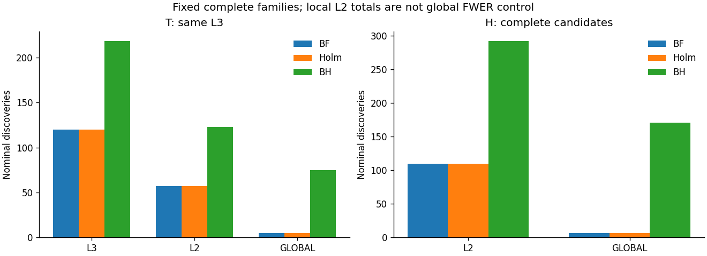
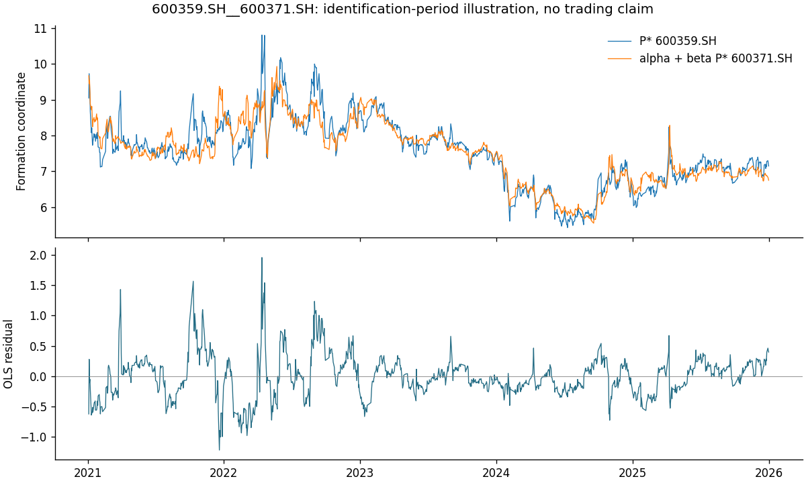
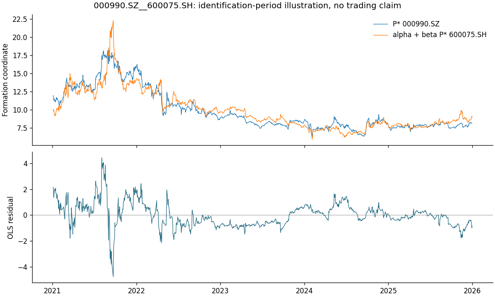
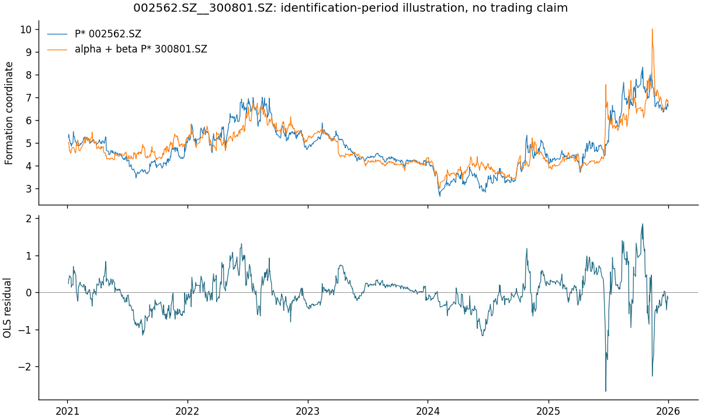

# 第一阶段统计报告

形成期：2021—2025；日历 1212 日。
审计后股票池 U=2984；候选 H=67678，T=28443，C=39235。
主清单共 110 对，见 main_evidence.csv，未按 beta、GLOBAL 结果或未来应用条件过滤。
其中T层 57 对、C层 53 对；
非正beta 9 对，按同一规则保留。

H中有效名义EG 42121 对；
预检占位 25557 对；
数值占位 0 对。
有限统计量尾部零 0 对，逐行保留来源与警示。

主结果是**各二级行业分别按名义0.05校正后的发现汇总**，不声明合并全市场FWER为5%。
在既定样本、模型规格和多重校正规则下，主表各对拒绝无协整原假设，获得协整证据。
名义校正发现，预定校准诊断尚未完成；实际模拟进度与警报见 simulation/。
**已执行的预定机制触发固定L2-Holm FWER警报：S0/N1, S0/N6, S1/N1。具体重复数、家族和Wilson区间见各阶段summary.csv；这是有限机制诊断，不改变主规格。**
不能把清单解释为已经实证验证的5%错误控制；未完成机制不记为通过，
也不按BH的FWER判定其FDR控制失效。已作的实现排查见simulation/中的独立记录。

完整逐对结果、冻结 U/H、逐股 ADF 与逐证券排除记录位于本地 .local/production/formation-2021-2025-v2。
families.csv 保留空家族、全部占位、零发现和各校正域；stock_flow.csv 包括 UNKNOWN。
view_overlap.csv 在T共同支持上比较九视角，在H上比较六视角。

行业来自当前申万官方历史变迁记录重建，不是2025当时归档快照。价格采用BaoStock记录值的
累计后复权坐标。原生坐标先以Decimal验证 raw×factor 与直接接口逐行完全相等，再除以同一首日因子；
该零误差恒等校验不推断供应商未公开的潜在因子舍入规则，也不等于独立核实所有公司行动。
样本限于来源覆盖的沪深市场、2025年底存续且满足五年严格连续交易条件的普通A股。
北交所未覆盖；不能外推至所有A股。

EG使用statsmodels 0.15.0的价格水平、常数项、AIC、maxlag=None路径及近似渐近MacKinnon p值。
Holm理论保证以输入p值有效为前提；BH还需要相应依赖条件。多重校正不修复模型错设或尾部近似误差。
近共线强制零作为数值占位；有限统计量的尾部零保留名义值并警示。未拒绝不证明无协整。
这些关系不证明永久均衡、未来收敛或交易盈利；第二、第三阶段均planned_deferred。

## 校正视角与形成期个案图

个案图按L2与candidate_id顺序选取前三个有发现行业的首对，仅用于检查形成期拟合与残差；完整发现见CSV。

## 完整视角计数与验收

|支持集|校正域|BF|Holm|BH|
|---|---|---:|---:|---:|
|T|L3|120|120|218|
|T|L2|57|57|123|
|T|GLOBAL|5|5|75|
|H|L2|110|110|292|
|H|GLOBAL|7|7|171|

L3只适用于T；H上的GLOBAL–Holm为7对，仅为对照，不作为主清单门槛。

独立验收重新按公式计算三域三方法，逐家族规模、终态、拒绝标记和主CSV全部一致。2,984只股票中2,335只与本版I(1)设定相容；预检不缩小候选家族。

全量3,616,608个冻结价格与60位Decimal参考比较，最大绝对浮点运算差约3.98e-13，全部在记录的binary64运算界内；供应商原生记录恒等验收仍为零容差。

S1的N1已完成1,000次：四个固定L2的Holm FWER分别为29.3%、28.1%、29.9%、32.0%，各95% Wilson下限均高于5%。N0、N2已完成；其他机制和S2尚未全部完成。不能把有限情景压力结果外推为市场实际FWER，也不能忽略这一警报。

输入口径与官方来源见[数据说明](../DATA_CONTRACT.md)，算法与统计前提见[原计划](../EXPERIMENT_PLAN.md)及[实施澄清](../REVIEW_AND_IMPLEMENTATION.md)。[独立验收](independent_acceptance.json)、[浮点审计](float_coordinate_audit.json)、[报告版本](report_version.json)分别保存证据。
