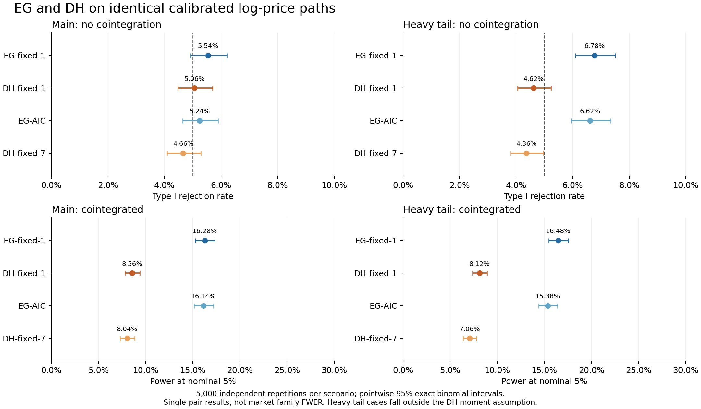

# 术语、方法与复现附录

本附录服务于[第一阶段最终实验报告](STAGE1_FINAL_REPORT.md)。正文先讨论研究问题和证据含义，本附录保留理解方法、复现结果所需的细节。

## 1. 术语表

|术语或符号|在本研究中的含义|阅读时要区分什么|
|---|---|---|
|协整（cointegration）|各价格序列可以不平稳，但存在非零固定线性组合是平稳的；本研究考察对数价格组合|一起涨跌或相关系数高，并不足以确认协整|
|平稳|序列的主要统计特征不随时间系统性改变，可直观理解为围绕稳定水平波动|不是每天不变，也不是每次偏离必然很快回来|
|一阶单整 I(1)|价格水平不平稳，一阶差分后平稳|这是方法适用条件之一；模拟中由结构规定，真实市场仍需诊断|
|对数价格与价差|令 x=log(P)，价差为 x_A−a−b·x_B，a为常数，b为两只价格的组合系数|价差通常不是 P_A−P_B；b也不是收益率|
|EG|Engle–Granger两步协整检验，先估计关系，再检验残差|本报告V1的主规格为固定1阶|
|OLS|Ordinary Least Squares，普通最小二乘，通过最小化拟合误差平方和估计回归关系|本次保存的log_ols_beta是全样本描述性价差系数，不直接规定交易仓位|
|递归回归|逐期使用截至该时点的数据重新估计关系|DH一阶的43个不可用位置发生在其实际使用的早期窗口，不能据此说整个价格样本缺失|
|ADF|Augmented Dickey–Fuller，增广迪基–富勒检验，用于考察单位根，即持续漂移|取消逐股入场门槛，不等于取消EG内部的残差检验|
|DH|Demetrescu–Hanck协整检验；本研究用两方程联合实现|本报告V2主规格为固定1阶；并非任意波动下都无条件有效|
|原假设与备择|原假设是没有协整，备择是存在协整|不拒绝原假设不等于证明没有协整|
|p值与5%名义水平|p值衡量在无协整假设及模型条件下，出现同样或更极端统计量的尾部程度；单对模拟按原始p<0.05记录检出；市场按Holm调整后p≤0.05判定|p值不是原假设为真的概率；名义5%也不等于已验证实际误报率为5%|
|误报率（第一类错误率）|没有协整的模拟样本中，被错误判为有协整证据的比例；源表字段为type_I_error|不是已发现股票对中错误关系的占比|
|检出率（功效，power）|确有协整的模拟样本中被检出的比例|1−检出率是该情景的漏检比例，不能直接转成市场漏检比例|
|数据生成过程（DGP）|产生模拟价格的规则，包含趋势、价差回复、共同冲击与波动变化|模拟参数参考市场，但模拟路径不是实际证券行情|
|AR与滞后阶数|AR表示用过去的量描述当前量；阶数规定纳入多少期滞后变化|EG的残差差分与DH的双变量差分是不同回归中的控制项|
|GARCH|让当前波动取决于过去冲击和过去波动的模型，用来表示“大波动后容易仍有大波动”|此处用于模拟冲击，不是直接用于预测股票收益|
|Student-t、自由度ν与厚尾|Student-t是一类分布；ν控制尾部厚度，较小ν对应更厚的极端尾部|ν不是样本量，也不同于检验统计量的卡方自由度|
|高阶矩条件|对极端冲击强度的数学约束，例如要求四阶以上的某个矩有限|主DGP约束有限4.1阶矩；个股ν=3.5对照不满足这一要求|
|VECM|向量误差修正模型：同时描述价格的短期变化和偏离长期关系后的调整|本DGP借它规定协整真值，不由检验结果反过来定义真值|
|ρ与φ|ρ描述短期动态；φ描述价差回复的持久性，越接近1回复越慢|φ=1为本DGP的无协整情景；备择φ≈0.9929|
|主导回复半衰期|模型中一个价差冲击的主导部分平均减半所需时间，约97.5个交易日|不是每条路径的承诺，也不是交易持仓建议|
|AIC|Akaike Information Criterion，赤池信息准则，在拟合与模型复杂度间取舍，用于选阶|本次是敏感性对照，不按结果替换主规格|
|95%置信区间|重复同样的完整模拟和区间构造时，约95%的区间会覆盖真实拒绝率；本次使用精确二项区间|这里是每格单独覆盖，不是所有区间同时覆盖，也不是收益区间|
|MCSE|Monte Carlo standard error，模拟标准误，描述有限重复造成的估计波动|两方法比较使用同路径指示差的标准误，不把两列当独立样本|
|多重检验校正、家族与FWER|同时检验一组候选称一个家族；FWER是其中至少一次错误发现的概率，校正用于约束这类整体错误|单对误报率不是全市场FWER；本次已并列计算L2/GLOBAL-Holm名义结果，整体校准仍未完成|
|数值不可用|程序无法得到可靠统计量的情况；按预定规则保留在分母并记为未拒绝|不能删除这些样本后只汇报有利比例；本次单对模拟为0，市场DH一阶为43|

## 2. 真实股票对识别的对象与本次输出

数据基础为2021—2025年形成期、2,984只股票及67,678个同业候选对。它是已有的研究输入，修订方案应对相同候选身份采用对数价格。样本限于数据来源覆盖、满足记录中连续性条件的沪深普通A股；行业按当前官方历史变迁资料重建，不是当时归档的行业快照。详细口径和局限见[数据契约](../DATA_CONTRACT.md)。

本次已生成的证据表列明：哪两个证券、属于什么行业、使用哪段形成期、采用哪个检验及阶数、原始p值是多少、在哪个校正域下得到什么调整结果、是否有数值或适用性限制。八份方法/校正域清单均已生成；零发现文件保留完整字段。

本次在查看p值前固定L2与GLOBAL两种Holm口径，四规格都对完整67,678个候选执行。结果和[完整证据清单](../results_revision/market_20261023/REPORT.md)为名义口径；尚未完成修订设计的完整共享股票图校准。

## 3. 共同数据生成过程及参数

在协整真值已知的两股票对数价格系统中，考察检验的误拒率、慢回复备择下的功效，以及厚尾扰动下的表现。DGP 参数依据 2021—2025 年形成期数据估计，在 Monte Carlo 中固定使用；不根据本批拒绝率调整参数或临界值。

共同 DGP 为 empirical-pair-dgp-1。令 x 为标准化价格系统、Pₛ=0.5×[[1,−1],[−1,1]]，则

\[
\Delta x_t=\Pi x_{t-1}+\Gamma\Delta x_{t-1}+\eta_t,\qquad
\Pi=-(1-\phi)(1-\rho)P_s,\quad
\Gamma=\rho(I-P_s)+\phi\rho P_s.
\]

伴随矩阵根为 1、φ、ρ、ρ：φ=1 时有两个单位根；φ<1 时有一个共同单位根和一个平稳价差。真值由该结构定义，不由检验输出决定。生成器直接返回 ln(100)+s·x 的对数价格，两条方法路线使用相同数组，不再次取对数。

|设计项|固定设定|
|---|---|
|共同短期 AR 系数 ρ|0.030371485236974884|
|协整备择 φ|0.9929170863604361，主导回复半衰期约 97.5 个交易日|
|尺度 s|0.02849551587244442|
|市场 / 行业 / 个股随机冲击方差份额|0.2536799981 / 0.1287034440 / 0.6176165579|
|主规格自由度|市场 ν=6、行业 ν=7、个股 ν=4.5|
|确定性项|无额外线性漂移，允许对数价格水平常数|
|观测与预热|1,212 个对数价格观测；预热 2,000 期|
|厚尾对照|仅将两条个股底层随机冲击的 ν 改为 3.5，其余参数与单位方差标准化不变|

四条底层冲击（市场、行业、两个个股）分别使用单位方差 Student-t 随机冲击和 GARCH(1,1) 递推：hₜ=ω+αe²ₜ₋₁+βhₜ₋₁。共享市场和行业冲击形成股票间依赖，个股冲击分别生成。主规格参数如下，实际计算使用 JSON 完整精度。

|冲击|ν|ω|α|β|
|---|---:|---:|---:|---:|
|市场|6|0.092311754|0.177649208|0.730039038|
|行业|7|0.040731892|0.092966848|0.866301261|
|个股|4.5|0.044708811|0.071184864|0.884106325|

主规格按有限 4.1 阶矩约束估计，个股聚合解贴近矩约束边界。φ 是形成期全部既定价差的描述性持久性参考，并不认定真实股票对协整。同质载荷、共同短期 AR 和零漂移限制了结论适用范围。估计与结构依据见[DGP 参数报告](../results_review/dgp_fixed_nu_2021_2025/REPORT.md)和[完整精度规格](../results_review/dgp_fixed_nu_2021_2025/dgp_spec.json)。

### 两种真值与两种尾部设定

|情景|协整真值|个股 ν|指标|
|---|---|---:|---|
|PAIR_NULL|无协整，φ=1|4.5|主规格误拒率|
|PAIR_COINT|协整，φ=估计值|4.5|主规格功效|
|HEAVY_NULL|无协整，φ=1|3.5|厚尾误拒率|
|HEAVY_COINT|协整，φ=估计值|3.5|厚尾功效|

每情景 5,000 条独立两股票路径，共 20,000 条。每条路径同时用于 EG 固定 1 阶、DH 固定 1 阶、EG-AIC、DH 固定 7 阶；前两者是主比较，后两者是选阶敏感性规格。全部四规格共 80,000 次检验。不同情景使用独立随机流；同一情景内的方法比较保留同路径配对。

两方法都不设置逐股 ADF 入场门槛，EG 内部残差 ADF 保留。固定方向 A 对 B，不尝试双方向后择优。主名义水平为 5%；1% 为同一 p 值输出的辅助水平，不增加模拟或拟合。工程阶段另有 20 条路径、80 次检验，不进入正式分母。

拒绝率以全部 5,000 条路径为分母；数值不可用记为未拒绝并单列。误拒率/功效区间采用逐格 95% 双侧 Clopper–Pearson 区间，配对差异 MCSE 为同路径拒绝指示差的样本标准差除以 √B。没有设置事后挑选规格的规则或硬性通过/失败门槛。

## 4. 两条方法的具体规格

本节记录单对模拟的内核规格和工作量。市场实验复用这些内核，真实候选范围与两域Holm校正另见第7节。

### V1：EG

第一步将 A 的对数价格对 B 的对数价格作含截距回归，第二步对残差作不另加截距或趋势的 ADF 检验。主规格固定一个残差差分滞后，autolag=None；使用双变量、含截距协整回归对应的 MacKinnon p 值，不使用普通单序列 ADF 的 p 值。

敏感性规格 EG-AIC 使用相同路径、方向和确定项，由 AIC 选阶，maxlag=None，并使用项目锁定的 statsmodels 版本。本路线共 20,000 次主规格检验与 20,000 次敏感性检验；同一结果同时报告 5% 和 1% 水平。

这里的“固定 1 阶”用于控制本 DGP 下的选阶差异，不是对真实市场最优阶数的判断。主检验只针对一对序列，不采用跨股票家族的多重校正。

### V2：DH

采用 DH 两方程符号工具变量联合检验。固定 A 对 B 作均衡关系归一化，使用递归去均值，不加入额外线性漂移或趋势。主规格固定一个价格差分滞后向量；统计量为两方程相关性修正后的联合 Q，按自由度为 2 的卡方参考分布计算 p=exp(−Q/2)，同时保留 log p。

敏感性规格仅将差分滞后向量数改为 7。两规格使用同一路径及相同数值规则，核对实际进入统计量的递归前缀。本路线共 20,000 次主规格检验与 20,000 次敏感性检验。

EG 的一个残差差分滞后与 DH 的一个两变量差分滞后向量分别属于各自回归，数值阶数相同不表示回归完全相同。本设计采用单对检验，无逐股 ADF 门槛，也不使用跨股票家族的多重校正。

## 5. 完整5%水平结果与选阶敏感性

下表保留四情景、四种规格的全部主水平结果。每格5,000条独立路径；区间为逐格95%双侧Clopper–Pearson区间。EG-AIC与DH-7是同一批模拟中的选阶敏感性规格。

|模拟情景与指标|EG-fixed-1|DH-fixed-1|EG-AIC|DH-fixed-7|
|---|---:|---:|---:|---:|
|主设定：没有协整，误报率|5.54% [4.92%, 6.21%]|5.06% [4.47%, 5.70%]|5.24% [4.64%, 5.89%]|4.66% [4.09%, 5.28%]|
|主设定：存在慢回复协整，检出率|16.28% [15.27%, 17.33%]|8.56% [7.80%, 9.37%]|16.14% [15.13%, 17.19%]|8.04% [7.30%, 8.83%]|
|厚尾设定：没有协整，误报率|6.78% [6.10%, 7.51%]|4.62% [4.05%, 5.24%]|6.62% [5.95%, 7.34%]|4.36% [3.81%, 4.96%]|
|厚尾设定：存在慢回复协整，检出率|16.48% [15.46%, 17.54%]|8.12% [7.38%, 8.91%]|15.38% [14.39%, 16.41%]|7.06% [6.37%, 7.81%]|

图中上排为没有协整时的误报率，下排为确有协整时的检出率；左右分别对应主设定和个股ν=3.5的厚尾对照。5%虚线只表示名义水平，不代表已通过错误控制验收。1%辅助结果在[完整统计CSV](../results_revision/pair_comparison/formal_summary.csv)中保留。

## 6. 执行、数值核对与保存结果

正式运行完成于 2026-10-21，主种子 20261021，正式随机流 21，工程流 20；每条正式路径的种子由主种子、流、情景序号和重复编号确定。4 个进程、BLAS=1，全部四规格正式计算墙钟 184.049 秒。报告使用已完成运行的保存结果，未重新计算实验。

80,000 行结果的覆盖、种子、实际阶数、有效观测数、p 值与汇总核对通过，数值不可用和 p 值零均为 0。另对四条正式路径的 16 次统计量作独立参照核对；适配、同路径输入、配对汇总和检查点复用的五项针对性测试通过。这些核对不构成对所有有限样本理论条件的证明。

- [冻结运行协议](../results_revision/pair_comparison/experiment_protocol.json)
- [完整统计汇总：32 行，含 1% 辅助水平](../results_revision/pair_comparison/formal_summary.csv)
- [同路径配对比较：16 行](../results_revision/pair_comparison/formal_paired.csv)
- [运行完成记录](../results_revision/pair_comparison/COMPLETION.json)与[独立核对记录](../results_revision/pair_comparison/formal_validation.json)
- [报告机器结果](FINAL_RESULTS.json)与[正式结果总览](README.md)

## 7. 全市场执行与核对

市场输入为冻结复权价格的自然对数，候选、顺序和方向保持不变。无逐股ADF门槛；对每只股票的对数水平和差分重新作ADF诊断，只保存提示，不改变候选家族。两域Holm均为alpha=0.05，数值不可用p=1，空家族保留。没有按beta、半衰期或2026表现过滤。

主规格EG/DH行业内Holm分别284/11对，全局Holm分别21/0对；EG-AIC为162/10对，DH-7为7/0对。完整对照、原始p诊断、逐对清单和重合表见[市场汇总](../results_revision/market_20261023/REPORT.md)。两方法的交集不是新主规则。

2,984股的诊断中2,437股相容，44,573个候选两股相容。EG行业内发现的148对、全局发现的11对有适用性警示；DH行业内发现的4对有警示。43个DH-1不可用位置均因B股前三个观测相同导致使用中的递归回归无法识别，按原规则占位，未修改统计量或家族规模。

实际四规格共同运行289.263秒，含逐股诊断14.932秒、配对阶段259.435秒及准备/汇总开销。每个规格67,678个位置，共270,712行；不能把核函数累计CPU或wall时间当作各自独立运行的墙钟时间。

核对覆盖冻结输入/统计源码、候选元数据、p值计算口径、有效观测与阶数、两域Holm、发现清单及汇总。八个事前固定候选位置的32个统计量另与coint/完整IV参考核对通过。核对程序曾遇到零发现CSV的空列类型问题，修正为显式数值读取后通过；市场检验未重跑。

[运行协议](../results_revision/market_20261023/protocol.json) · [完成记录](../results_revision/market_20261023/COMPLETION.json) · [独立核对](../results_revision/market_20261023/validation.json) · [发现清单诊断](../results_revision/market_20261023/discovery_diagnostics.csv)。

## 8. 方法来源与文献范围

- EG的检验假设、常数项、AIC选阶与MacKinnon p值说明：[statsmodels coint官方文档](https://www.statsmodels.org/stable/generated/statsmodels.tsa.stattools.coint.html)。
- Demetrescu, M. and Hanck, C. (2018), *Multiple Testing for No Cointegration under Nonstationary Volatility*, Oxford Bulletin of Economics and Statistics, 80, 485–513。[出版方页面](https://onlinelibrary.wiley.com/doi/abs/10.1111/obes.12214)。本项目使用其两方程联合检验实现；不能将论文条件下的结论扩展到所有价格过程。
- 本DGP参数来自[形成期参数估计报告](../results_review/dgp_fixed_nu_2021_2025/REPORT.md)，统计结果来自上方已保存CSV和核对记录。

本附录保存已执行的模拟与2026-10-23新增市场实验；后续统计错误控制校准未被记为已完成。历史设计与实验仍在[归档索引](../archive/README.md)中独立保留。
