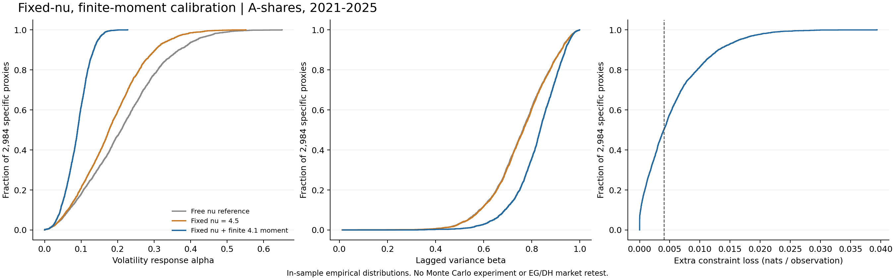

# 固定自由度、有限4.1阶矩的DGP估计

完成时间：2026-10-21T20:32:19.424208+08:00。用户授权固定市场ν=6、行业ν=7、个股ν=4.5，使用已有2021—2025年数据重新估计AR/GARCH并形成可执行DGP；个股ν=3.5保留为厚尾对照。

**已完成3,106条代理序列的两种规格，共6,212个模型记录，并形成一个参数已估计、协整真值明确的两股票对数价格DGP。没有运行Monte Carlo、EG/DH市场重算、2026年样本外检验或恢复V3。**

## 1. 数据与识别范围

- 复用冻结formation-2021-2025-v2中的2,984只股票、1,212个价格观测，以及既有代理序列；1,211个日对数收益，AR模型有效观测1,210。
- 重新估计市场代理1条、行业剩余代理121条、个股剩余代理2,984条。原始收益未截尾、未缩尾；没有逐股ADF门槛。
- 代理是描述性分解，不是唯一识别出的结构冲击。原股票池要求持续覆盖与存续，不代表全部曾上市A股。
- 股份名称、原始价格、收益与逐序列参数留在.local目录。此目录中的汇总和DGP系数可独立审阅。

## 2. 固定ν与矩约束的估计

逐序列拟合r_t=c+ρr_(t−1)+ε_t，ε_t=√h_t z_t，h_t=ω+αε_(t−1)²+βh_(t−1)，z_t为单位方差Student-t。现有自由ν拟合作参考；新规格依次是：

1. 固定ν，保留普通GARCH的α+β≤1边界，用于隔离固定自由度造成的损失；该参考规格不被直接用作DGP。
2. 同样固定ν，要求|ρ|<1及K4.1=E[(αz²+β)^2.05]≤0.999999，得到严格有限4.1阶矩。1e−6只是严格不等式的数值间隔，不表示远离边界。

矩函数用Beta积分的超几何函数表达式计算；优化坐标按α/(α+β)及可行持续性比例构造，所以全过程满足约束。使用arch 8.0.0的方差递推与Student-t似然、SciPy SLSQP和预定的两个起点。取较优收敛解，不宣称全局最优保证。部分已可行的固定ν最优解直接复用。

主估计本机4进程、BLAS=1，30.03秒完成全部3,106条序列。另有7条真实序列的预运行。为保证嵌套似然比较公平，新的固定ν拟合暴露出的3个旧自由ν局部最优已在本轮另存重估参考；旧自由度诊断文件没有覆盖。

## 3. 个股参数变化与拟合损失

|规格|ρ中位数|α中位数|β中位数|α+β中位数|
|---|---:|---:|---:|---:|
|Free nu reference|-0.04438|0.20979|0.76331|0.99111|
|Fixed nu = 4.5|-0.04267|0.17673|0.76566|0.95454|
|Fixed nu + finite 4.1 moment|-0.04367|0.09039|0.83512|0.92576|

每列独立取中位数，不能把中位α与中位β相加当成持续性中位数。新增矩约束改变了即时冲击反应与持续性，两者都必须报告。

在固定ν=4.5已经重新优化之后，加入矩约束的个股额外对数似然损失Δℓ=ℓ_fixed−ℓ_constrained：

- 中位数4.858860，90%分位15.790704，95%分位19.974650，最大47.686455。
- 每个观测的中位损失0.00401559 nats；比较使用完全相同的数据、尺度和似然初始化。
- 相比自由ν参考，总损失的中位数为9.026796。不同损失的中位数不能直接相加。
- 个股有2835/2984组贴近矩约束边界；行业为18/121，市场为0/1。

这只是训练内拟合代价，不是预测准确率或收益损失，也没有用普通卡方分布作边界约束似然比检验。约95%的个股触及边界，说明约束确实限制了数据偏好的尾部与波动组合；数学上存在矩不等于有限样本表现已得到验证。



## 4. 最终两股票DGP

### 4.1 为什么采用共同短期AR

直接叠加具有不同AR滤波的潜在市场、行业和个股趋势，不自动证明被检验的两个股票价格构成DH要求的闭合线性动态系统。本参考DGP因此将短期动态直接写在两股票VECM中，并用全体股票标准化收益的合并回归估计一条共同ρ。逐代理的自由ρ估计仍完整保留在第3节和本地参数表。

估计ρ=0.030371485237。固定该ρ后，对已有代理去模型均值、应用共同AR滤波并按各自创新样本标准差标准化；在有限矩约束下重新估计三个组的共同GARCH形状。它是等序列权重的复合似然参考，不把相关股票当独立样本进行区间推断。

每个底层冲击ε_k,t=√h_k,t z_k,t，h_k,t=ω_k+α_k ε_k,t−1²+β_k h_k,t−1；底层z在时间和成分间独立，具有相应单位方差t分布。下表使用ω=1−α−β，使各底层ε的无条件方差为1：

|成分|ν|α|β|ω|K4.1|
|---|---:|---:|---:|---:|---:|
|市场|6.0|0.177649208|0.730039038|0.092311754|0.996333978|
|行业|7.0|0.092966848|0.866301261|0.040731892|0.956142750|
|个股|4.5|0.071184864|0.884106325|0.044708811|0.999999000|

**实际生成必须读取dgp_spec.json中的完整精度；不得把表格圆整值复制为最终机器参数。个股聚合解也贴近矩边界。**

### 4.2 创新相关结构与尺度

在去共同AR后的标准化股票收益上，用4,382,958个跨行业配对和67,678个同业配对的平均协方差估计三个方差份额。未构造庞大的协方差矩阵，采用行业和全市场求和恒等式；三个估计份额均为正，没有事后裁剪。

- 市场v_M=0.253679998，行业v_G=0.128703444，个股v_I=0.617616558，合计1。
- 同业创新相关系数参考为v_M+v_G=0.382383442；跨行业平均协方差仅用于分解市场份额，不声称单对生成器已复现跨配对依赖网络。
- 两股各有独立个股冲击，共享市场和行业冲击。η_i,t=√(1−ρ²)(√v_M ε_M,t+√v_G ε_G,t+√v_I ε_i,t)。个股份额严格为正，因此两方程创新协方差非退化。
- 最后乘股票日对数收益标准差的样本中位数s=0.028495515872，对应约2.850%日波动；再加log(100)作为价格水平常数。零假设下该归一化使日增量的无条件标准差为s。

### 4.3 已知真值的零假设与备择

定义P_s=0.5×[[1,−1],[−1,1]]，P_c=I−P_s。两股票标准化对数价格x满足：

    Δx_t = Π x_(t−1) + Γ Δx_(t−1) + η_t
    Π = −(1−φ)(1−ρ) P_s
    Γ = ρ P_c + φρ P_s

- 零假设：φ=1，Π=0；两条独立永久方向都存在，两股均为I(1)，没有协整。
- 备择：φ=0.992917086360；Π秩为1，x_1−x_2平稳。伴随矩阵根为1、φ、ρ、ρ，只有一个单位根。平稳价差有两个稳定根φ与ρ，约97.51个交易日是主导根对应的回复半衰期。
- φ来自全部67,678对经固定波动尺度标准化的对数价差：对s_t−ρs_(t−1)拟合含常数AR(1)，取未筛选估计的中位数。其10%/90%分位为0.982520/0.997849；891对点估计不在(−1,1)内，仍保留在统计中。
- 这一步给备择回复速度提供描述性市场量级；有限样本价差回归可能呈现伪回复，**φ小于1不能据此认定真实股票对协整**。模拟真值由Π的结构设置，而不是由市场检验结果贴标签。
- 个股ν=3.5厚尾对照只替换两条个股底层z的自由度，仍作单位方差标准化；ρ、φ、GARCH系数、权重与尺度都保持不变。该对照没有有限四阶矩，不属于DH的既定矩假设范围。

### 4.4 适用条件与尚未检验的内容

主DGP是明确的有限阶两方程系统，无确定性漂移；短期根稳定、创新具有非退化常数无条件协方差，GARCH冲击是鞅差。正ω与Student-t密度给出有界条件密度，K4.1<1给出统一有限4.1阶矩；备择的协整秩及无I(2)结构由矩阵根直接核对。上述结构与EG的稳定短记忆/函数极限定理设定以及DH的相关动态和矩条件相容。平稳条件异方差不等于原N5—N7的非平稳方差断点。

实际EG/DH选阶、有限样本p值和错误率、功效及多重校正仍需后续模拟验证。本DGP用于两股票检验比较，不复现2,984股、67,678条共享股票边的完整家族图。扩展到该图不能默认继承本两方程结构保证。

## 5. 核对与复现

- 四项新测试通过：分数阶矩与独立积分、四阶解析式及可行参数化、已知协整秩与根、两期固定冲击递推。后者不调用随机数生成。
- 全部6,212模型的任务覆盖、相同观测数、逐对嵌套似然关系和所有约束核对通过；参考中3个旧局部最优单独修复并留痕。
- 22个实际拟合结果采用独立OLS初始化、手写方差递推和SciPy Student-t密度核对，最大对数似然差4.55e-13；同样22个矩函数与独立积分最大差2.83e-13。抽样核对不等于独立重优化全部模型。
- 参数CSV与dgp_spec.json已保存；生成器已实现，但未调用它生成随机面板或运行检验。工程测试只使用两个时点的固定冲击。

文件：

- [机器DGP规格](dgp_spec.json)、[三类驱动参数](dgp_driver_parameters.csv)、[参数比较](parameter_comparison.csv)、[价格结构估计](price_structure.json)。
- [完整核对](validation.json)、[全量拟合执行记录](execution.json)、[结构估计执行记录](construction_execution.json)。
- [固定ν估计脚本](../../scripts/calibrate_dgp.py)、[参考修复和DGP构造](../../scripts/complete_dgp_calibration.py)、[本报告与核对脚本](../../scripts/report_dgp_calibration.py)、[矩函数和生成器](../../src/dgp_calibration.py)。
- 本地完整参数：[两种固定ν拟合](../../.local/review/dgp_fixed_nu_2021_2025/estimates.csv)、[自由ν参考](../../.local/review/dgp_fixed_nu_2021_2025/free_nu_reference.csv)、[参考修复记录](../../.local/review/dgp_fixed_nu_2021_2025/reference_repairs.json)、[逐序列损失](../../.local/review/dgp_fixed_nu_2021_2025/per_series_fit_loss.csv)、[全部价差持久性](../../.local/review/dgp_fixed_nu_2021_2025/pair_persistence.csv)。

复现顺序为calibrate_dgp.py、complete_dgp_calibration.py、report_dgp_calibration.py。拟合入口拒绝覆盖既有journal；重做时使用单独输出目录或副本。仅重新汇总可运行report_dgp_calibration.py，不会拟合或模拟。既有arch运行时位于.local/diagnostics_runtime/arch-8.0.0，未改动原虚拟环境依赖。

以后得到模拟授权后，生成器可读取完整JSON调用：

```python
import json
from pathlib import Path
from src.dgp_calibration import generate_pair
spec = json.loads(Path('results_review/dgp_fixed_nu_2021_2025/dgp_spec.json').read_text())
# Following example is documented only; it was not executed in this estimation run.
log_prices = generate_pair(spec, n_obs=1212, seed=20261021, cointegrated=False)
```

方法依据：[DH 2018](https://onlinelibrary.wiley.com/doi/abs/10.1111/obes.12214)、[Phillips–Ouliaris残差ADF理论](https://cowles.yale.edu/sites/default/files/2022-08/d0847-r.pdf)、[GARCH矩条件示例](https://mpra.ub.uni-muenchen.de/27685/1/MPRA_paper_27685.pdf)。
