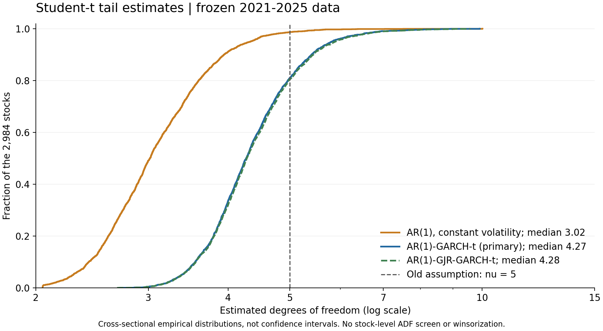

# 2021—2025年Student-t自由度诊断

完成日期：2026-10-21T19:06:58.570850+08:00。仅使用现有冻结形成期数据做参数估计；没有生成DGP面板、运行Monte Carlo、重算EG/DH配对或恢复V3。

**主要结果：个股AR(1)-GARCH-t的自由度中位数为4.271，非对称波动敏感性规格为4.279。统一固定ν=5没有得到普遍支持；它可以作为部分序列的近似参考，不能当成所有市场、行业和个股创新已经验证的共同参数。**

## 1. 数据和估计对象

- 输入：formation-2021-2025-v2的prices.npy、U.parquet、freeze.json，均只读；2,984只股票，2021-01-04至2025-12-31的1,212个价格观测。
- 收益为r=100×Δlog(P*)，每股1,211个观测；AR(1)均值回归使用1,210个有效观测，2021-01-06至2025-12-31。
- 股票池沿用已有严格连续交易、来源覆盖和存续资格，不代表所有曾上市A股；未按ADF或协整p筛选，未截尾、缩尾或删除极端收益。观察到的日对数收益百分数范围约−22.41至18.41。
- 各序列在拟合前除以自己的固定样本标准差以改善数值尺度，之后方差参数换回原单位。此固定缩放不消除波动聚集，ν对固定正尺度变换不变。

## 2. 方法

主规格为：

    r_t = c + phi*r_(t-1) + epsilon_t
    epsilon_t = sqrt(h_t)*z_t
    h_t = omega + alpha*epsilon_(t-1)^2 + beta*h_(t-1)
    z_t ~ sqrt((nu-2)/nu) * t_nu

最后一行使创新方差为1。ν越小，模型的渐近尾部越重。使用arch 8.0.0联合极大似然估计均值、波动和ν，不是先把所有股票混为独立样本后拟合一个t分布。

两个预先确定的对照都使用同样的AR(1)均值和观测窗口：恒定方差t用于展示不处理波动变化时的有效尾参数；GJR-GARCH-t额外加入负冲击的不对称波动反应，检查主结论对这一设定是否敏感。三种规格全部报告，不按ν是否接近5选模型。

代理诊断只用主GARCH-t规格：

- 市场代理：冻结股票池的等权收益。
- 行业代理：至少5股的121个L2行业等权收益，对“排除本行业的市场收益”作含截距回归后的残差。
- 个股剩余代理：个股收益对留出自身的市场及同行业收益作含截距回归后的残差；行业不足5股的21只股票仅使用留一市场项，其余2,963只使用两项。

这些是可观测的描述性代理，不是唯一识别出的结构性永久趋势创新或平稳价格误差。收益剩余成分也不能直接等同原DGP中的e_t。

## 3. 结果

|序列及模型|序列数|ν中位数或单序列估计|横截面25%–75%|横截面10%–90%|
|---|---:|---:|---|---|
|个股：AR(1)＋恒定方差t|2984|3.018|2.667–3.478|2.422–3.940|
|个股：AR(1)-GARCH-t（主规格）|2984|4.271|3.876–4.794|3.554–5.408|
|个股：AR(1)-GJR-GARCH-t|2984|4.279|3.887–4.821|3.560–5.434|
|等权市场代理|1|6.003|—|—|
|去市场后的行业代理|121|6.918|5.412–8.652|4.644–13.179|
|个股剩余成分代理|2984|3.512|3.228–3.966|3.007–4.684|

以上分位数描述已观测序列之间的差异，**不是置信区间**；市场代理只有一条序列。

恒定方差模型的中位数约3.02，GARCH处理后约4.27，说明一部分表观厚尾与波动变化有关。GJR的中位数约4.28，未改变这一总体判断。没有把恒定方差估计当成已分离的创新自由度。

市场代理ν=6.003，近似95%区间为[3.698, 8.308]，包含5。行业代理中位数更高，而个股剩余代理中位数更低，表明使用一个共同ν掩盖了成分差异。

## 4. 不确定性与模型诊断

逐序列区间采用arch的robust夹心标准误和正态近似：nu_hat±1.96*SE。它不是有限样本保证，也没有对跨股票/模型比较提供同时覆盖；robust并不意味着对任意剩余时序失配都有效。代理区间未计入第一步因子回归估计的不确定性。

主规格中，276只股票的波动参数位于或接近约束边界，不作普通Wald区间判读；其余2708只中：

- 969个近似区间上界低于5；
- 1739个区间包含5；
- 0个区间下界高于5。

这不是把969只股票宣布为经过多重校正的“拒绝ν=5”清单；区间包含5也不证明分布就是真实t5。只看非边界主规格，ν中位数为4.300，与全体4.271接近。

主规格标准化残差的10阶Ljung–Box诊断中，残差p<0.05有106/2984，平方残差有92/2984；恒定方差模型的平方残差对应为2982/2984。这些是拟合后近似诊断，不作新的股票筛选或独立重复的整体显著性声明。

个股剩余代理有1088个波动约束边界项，明显更多；其ν中位数3.512应更谨慎解释，非边界子集的中位数为3.659。边界可能涉及高度持久波动或模型不足，不在本轮强行解释为一种已确定的经济原因。

主规格有999个ν点估计低于4。理想t分布在ν≤4时没有有限四阶矩，但这里估计的是有限样本下的近似尾参数，不能据此证明真实股票收益具有无限四阶矩，更不能直接把ν调低后声称满足EG/DH的全部理论条件。

## 5. 对DGP参数的含义

1. 不将ν=5继续标为“已由市场验证的统一自由度”；本次数据支持显著的序列和成分差异。
2. 对个股完整收益创新，约4.3是主模型的横截面中心，约3.55–5.41覆盖中央80%的股票点估计；这是描述范围，不是新模拟已冻结的取值。
3. 市场代理约6、行业剩余代理中位约6.9、个股剩余代理中位约3.5，不能用完整股票收益的4.3直接替换原DGP三类潜在驱动的共同ν。
4. 原模型把多个t驱动及平稳误差相加，最终股票收益一般不再恰好服从同自由度的t分布。因此本次诊断还不等于完成新DGP的分布校准。
5. 对未来DGP，应先明确潜在成分的定义和理论适用范围，再用这些估计约束参数；不能为了检验通过而把ν硬调到5，也不能因为拟合更厚尾就忽略矩条件。

## 6. 工程核对与复现

共完成12,058个规格估计（2,984股×3模型，以及市场1、行业121、个股剩余2,984个主模型）。初次有2个优化未收敛，另有1个GJR似然低于嵌套GARCH；仅对这3项使用确定的可行/嵌套起点重新优化，全部收敛，原始估计和修复记录保留。没有按ν大小删除序列或挑选更接近5的结果。

本机4进程、BLAS=1；拟合、定向修复和汇总的计时累计110.99秒，不含资料阅读与报告制作。

全量任务覆盖、模型观测数、汇总分位数及区间计数核对通过；全部股票的GARCH似然不低于恒定方差、GJR不低于GARCH。另对15个实际拟合结果（含3个修复项）用SciPy独立的单位方差t密度表达式核对对数似然，未重新拟合或模拟。软件收敛和密度核对不等于统计模型完全正确。

- [估计脚本](../../scripts/diagnose_student_t.py)；[核对与报告脚本](../../scripts/finalize_student_t.py)
- [方法记录](method.json)；[执行记录](execution.json)；[核对记录](validation.json)
- [汇总CSV](summary.csv)；[分行业汇总](by_industry.csv)
- [逐序列估计，保留本地](../../.local/review/student_t_2021_2025/estimates.csv)
- [初始估计](../../.local/review/student_t_2021_2025/initial_estimates.csv)；[3项优化修复](../../.local/review/student_t_2021_2025/optimizer_repairs.json)

arch 8.0.0位于项目.local/diagnostics_runtime/arch-8.0.0，未改变原.venv锁定依赖。估计脚本遇到现有结果会拒绝覆盖；本轮全部结果保留。原V1/V2源码、协议和结果未修改，V3仍暂停。

方法参考：[arch的t创新与波动模型](https://arch.readthedocs.io/en/stable/univariate/univariate_volatility_modeling.html#student-s-t-errors)、[标准化t对数似然](https://arch.readthedocs.io/en/stable/univariate/generated/generated/arch.univariate.StudentsT.loglikelihood.html)、[参数区间接口](https://arch.readthedocs.io/en/stable/univariate/generated/generated/arch.univariate.base.ARCHModelResult.conf_int.html)。
