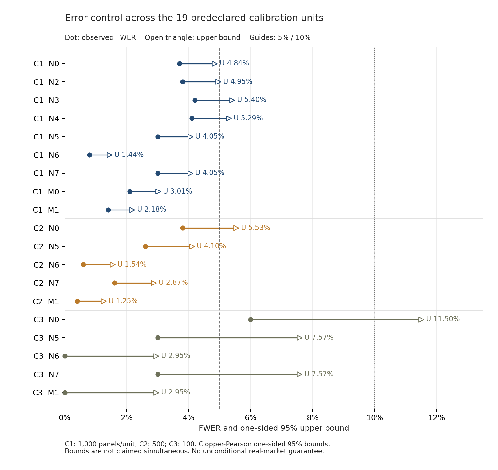
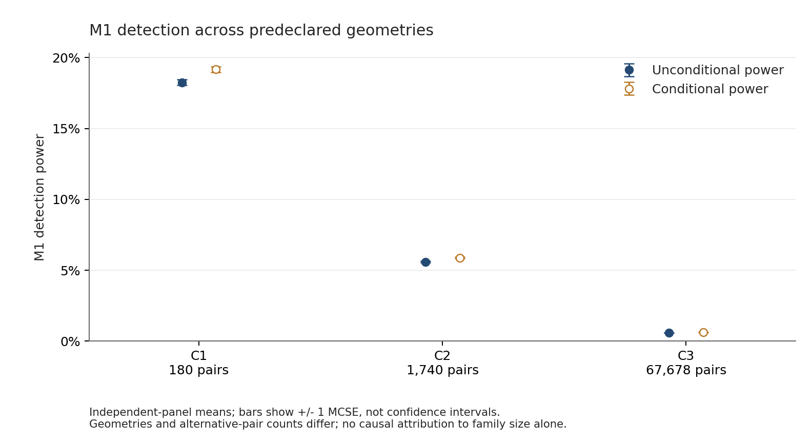

> 历史报告：本文件保留原阶段结果与当时口径。结合补充实验的现行综合结论见 [V2 最终报告（2026-10-22）](../results_final/V2_FINAL_REPORT.md)；本报告原文已收入日期归档。

# V2.1-DH：正式校准总报告

报告时间：2026-10-20T13:45:56.651043+08:00。F0冻结时间：2026-10-20T09:39:54.405334+08:00。

**全部预定正式计算与独立核对完成，整体统计验收为证据不足（inconclusive）。** C1/C2/C3共18000个独立面板、40889000次DH联合系统检验；19项必需验收中13项严格、5项容忍、1项证据不足，0项明确失败。

**触发整体证据不足的是C3-N0。** 100个完整面板中有6个出现至少一次真零假发现，FWER为6%，单侧95%上界11.50%，没有满足U≤10%。下界2.64%，也未达到L>10%的明确失败标准。

## 1. 固定设计与覆盖

|阶段|人工几何|每机制B|面板数|DH检验数|计算计时|阶段结论|
|---|---|---:|---:|---:|---:|---|
|C1|4×10股；180对|1000|15000|2700000|44.34分钟|容忍通过|
|C2|4×30股；1740对|500|2500|4350000|20.78分钟|容忍通过|
|C3|131行业；2984股、67678对|100|500|33839000|120.71分钟|证据不足|

计算计时合计11149.913秒（185.83分钟），不含阶段间实现、检查、报告及等待时间。各阶段本机8个worker、BLAS=1，首批60/20/10面板全部保留并复用。
C1包含15机制，其中A0–A5只作功效实验；C2/C3各包含预定5个重点机制。所有阶段固定1212期、7阶、ADF门槛及完整GLOBAL-Holm。正式样本与D0/D1分离；D0/D1不计入验收，N1继续排除并保留覆盖限制。

## 2. 全部19项错误控制验收

FWER以独立完整面板为单位，平均1(V>0)，同面板多个错误配对只记一个事件。L/U分别为单侧95% Clopper–Pearson界，不构成95%双侧区间，也不声称跨机制同时覆盖。严格通过要求U≤5%，容忍通过要求5%<U≤10%，失败要求L>10%，其余为证据不足。名义alpha始终为0.05。

|阶段|机制|错误事件/B|FWER|下界L|上界U|MCSE（百分点）|判定|
|---|---|---:|---:|---:|---:|---:|---|
|C1|N0|37/1000|3.70%|2.77%|4.84%|0.597|严格通过|
|C1|N2|38/1000|3.80%|2.86%|4.95%|0.605|严格通过|
|C1|N3|42/1000|4.20%|3.21%|5.40%|0.634|容忍通过|
|C1|N4|41/1000|4.10%|3.12%|5.29%|0.627|容忍通过|
|C1|N5|30/1000|3.00%|2.17%|4.05%|0.539|严格通过|
|C1|N6|8/1000|0.80%|0.40%|1.44%|0.282|严格通过|
|C1|N7|30/1000|3.00%|2.17%|4.05%|0.539|严格通过|
|C1|M0|21/1000|2.10%|1.41%|3.01%|0.453|严格通过|
|C1|M1|14/1000|1.40%|0.85%|2.18%|0.372|严格通过|
|C2|N0|19/500|3.80%|2.50%|5.53%|0.855|容忍通过|
|C2|N5|13/500|2.60%|1.54%|4.10%|0.712|严格通过|
|C2|N6|3/500|0.60%|0.16%|1.54%|0.345|严格通过|
|C2|N7|8/500|1.60%|0.80%|2.87%|0.561|严格通过|
|C2|M1|2/500|0.40%|0.07%|1.25%|0.282|严格通过|
|C3|N0|6/100|6.00%|2.64%|11.50%|2.375|证据不足|
|C3|N5|3/100|3.00%|0.82%|7.57%|1.706|容忍通过|
|C3|N6|0/100|0.00%|0.00%|2.95%|0.000|严格通过|
|C3|N7|3/100|3.00%|0.82%|7.57%|1.706|容忍通过|
|C3|M1|0/100|0.00%|0.00%|2.95%|0.000|严格通过|

圆点为FWER，空心三角为单侧95%上界，竖线为5%和10%。其他单元通过不能替代C3-N0，也不能把整体改记为通过。

## 3. 功效与实用性限制

无条件功效包含全部真备择（包括预检淘汰项）；条件功效以通过预检且数值有效的真备择为分母，再对有定义的面板平均。MCSE采用重复级样本标准差/sqrt(B)。

|阶段|机制|无条件功效|条件功效|无条件MCSE（百分点）|条件有效B|
|---|---|---:|---:|---:|---:|
|C1|A0|95.047%|99.896%|0.3510|1000|
|C1|A1|93.442%|99.828%|0.3781|1000|
|C1|A2|22.982%|24.357%|0.1862|1000|
|C1|A3|22.596%|23.965%|0.1916|1000|
|C1|A4|0.151%|0.162%|0.0097|1000|
|C1|A5|0.147%|0.161%|0.0092|1000|
|C1|M0|20.821%|22.120%|0.2154|1000|
|C1|M1|18.250%|19.173%|0.2016|1000|
|C2|M1|5.598%|5.889%|0.0588|500|
|C3|M1|0.597%|0.625%|0.0081|100|

图中误差棒为±1个MCSE，不是置信区间。M1每面板真备择为48、528、21469个；无条件功效依次18.25%、5.60%、0.597%。成员数、备择配对数及校正规模同时变化，这里不把变化单独归因于某一个因素。
C1的A4/A5（phi=0.99）功效仍约0.15%；C3的M1（phi=0.95）条件功效也仅0.625%。低错误率与弱检出能力可以并存，当前结果不构成实用性充分的证据。

## 4. 工程核对与记录

- 前续44项实现测试及新增5项市场专项测试通过。正式校准共40889000行配对和2392000条逐股ADF审计完成独立核对，数值不可用0、指数下溢0。
- 核对候选身份、模拟真值、占位、独立Holm、FWER事件、功效分母、MCSE及CP二项尾部；没有重跑DH/ADF。
- 核对程序曾发生Windows原生访问冲突和对象列近似比较路径异常。串行读取未解决，已撤销该尝试；改为冻结元数据精确比较、按冻结股票索引计算预检掩码后，500面板全部核对通过。另用纯Python独立核对500个面板的预检通过数量，全部一致。底层原生异常原因未完整定位，失败日志保留；没有升级依赖、改动统计内核或重跑DH/ADF。
- C3中途吞吐变化时CPU持续增长且内存余量充足，保留原任务继续完成；真实调用时间和源码/环境快照均已保存。
- V1代码、冻结数据、110对名义发现与既有失准结论保留；D1和C1/C2原报告不回填改写。F0时间没有回填。

## 5. 市场口径与限制

19项验收中13项严格、5项容忍、1项证据不足，整体仍为inconclusive。根据持续目标要求完成全量结果，后续采用计划第9节的名义市场清单分支，并明确标记校准证据不足；不扩样、改阶、换机制或把该结论改记为通过。
当前不能声称真实市场FWER已被验证在5%或10%以内。C3只覆盖5类重点人工机制，N1排除、无额外确定性线性漂移、有限样本7阶等限制继续有效。
后续仍是同一冻结数据上的稳健性再分析，不是独立样本确认；不涉及2026表现、券源、交易成本、盈利或未来收敛。远端及研究第二、第三阶段保持未启动。

## 6. 可定位证据

- [C1报告](simulation/C1_REPORT.md) · [C2报告](simulation/C2_REPORT.md) · [C3报告](simulation/C3_REPORT.md)
- [C1汇总](simulation/C1_summary.csv) · [C2汇总](simulation/C2_summary.csv) · [C3汇总](simulation/C3_summary.csv)
- [C1核对](simulation/C1_validation.json) · [C2核对](simulation/C2_validation.json) · [C3核对](simulation/C3_validation.json)
- [F0记录](F0_FREEZE.md) · [实验计划](../EXPERIMENT_PLAN_V2.md) · [工程安排](../ENGINEERING_CHANGES.md)
- [图表生成程序](../scripts/plot_dh_calibration.py)

## 市场执行补记（2026-10-20T14:30:41.742378+08:00）

全量67678个候选位置已完成并核对，GLOBAL与L2名义发现均为0。未使用递归前缀的市场边界修复通过23对独立IV参考核对和其余67655行原始审计量一致性检查；市场专项测试现为7项。原正式校准结果不变，整体仍证据不足。详见[最终市场报告](STAGE1_REPORT_V2.md)。
