# BP单因子测试报告

方法版本0.5 · 2026-10-26 · 全部 A 股、沪深300与中证500

## 摘要

本文检验正且有限历史PB倒数所构成的BP因子，预期高BP对应较高下期收益。采用月末信号、下一交易日收盘换仓、行业与规模控制、WLS、Rank IC及扣教材成本的等权分层，三池共同评价2007-02至2026-01归属的228个完整持有期。全A平均Rank IC为0.0566，正向月份162/228；五层年化净收益由4.55%递增至20.98%，多空年化13.00%，Q5相对内部基准的算术年化超额5.31%。指数池方向相同而强度较弱。行业共同窗口中Q5在19/30个可比行业排名第一；房地产、钢铁等行业为负超额，综合行业样本不足。2025年正IC与负多头超额并存，低市值域的排序关系更强。结论是保留BP作为后续研究候选，观察时变性与行业边界；历史版本修订、估值近似及简化成本使本结果不能直接解释为严格PIT或实盘可实现收益。

## 1. 研究背景与因子定义

单因子测试先回答一个有限问题：同一期股票之间的因子差异，能否对应下一持有期的收益差异。本文按课程附录，以回归、Rank IC和分层三条证据评价BP，并进一步检查不同股票池、年份、行业和市值域。目标是判断BP是否值得进入后续多因子研究，不构造完整交易系统，也不把本次回测解释为可直接执行的投资方案。

账面市值比（Book-to-Price，BP）衡量账面净资产相对市场价格的水平。高BP可能反映较低估值；其后收益较高可能与风险补偿或错误定价有关。但资产减值、盈利能力差异和持续经营风险也可能形成“价值陷阱”。这些是待检验解释，本报告的观察性设计不能区分因果机制。

| 项目 | 本报告定义 |
| --- | --- |
| 经济概念与实际变量 | 经济概念为账面权益/总市值；实际采用供应商历史日度 `pb` 的倒数 |
| 公式与单位 | `BP = 1 / pb`，无量纲比值；只取正且有限的PB |
| 来源与口径边界 | 课程离线Tushare历史估值字段；供应商定义及有限财务样本已核对，未自行重建逐版本财报PIT数据库 |
| 频率与方向 | 交易月末收盘后取值；预先假设高BP对应较高下期收益，Q5始终为高残差层 |
| 无效值 | 缺失、零、负、无穷PB均不填补；这是因子定义域限制，不称为去极值 |
| 规模变量 | 中性化和WLS控制使用总市值；WLS权重、市值三分域使用流通市值；源单位为万元 |

这一口径依赖供应商历史PB的财务定义和修订规则，不能无条件等同于当时投资者可取得的原始披露版本。全文统一使用“全部 A 股”“内部等权基准”“年化净收益”“算术年化超额”和“Rank IC”，避免把不同收益口径混称为alpha。

## 2. 数据范围与形成时点

三池共同信号期为2007-01至2025-12，共228期；实际建仓从2007-02-01收盘开始，最后退出为2026-02-02收盘。持有期归属2007-02至2026-01。另保留2026-01-30这一最新完整信号截面作诊断，其未来退出日超出行情截止，未进入绩效。

全部 A 股沿用课程沪深京人民币权益证券覆盖，含库内境内上市CDR；北交所从2021-11-15开市后纳入。股票池使用历史生命周期、历史指数成员、历史行业和历史ST/PT状态。入场按下一交易日收盘可交易判断，日内临停但收盘恢复者可保留。沪深300和中证500均使用历史真实成员，没有以当前名单或市值排名替代。

样本依次为U（历史合格池）、F（U中正有限PB）、S（F中行业与市值控制变量可用）、Y（S的后续收益可评价）。去极值、中性化和持仓在S上冻结，之后才接入收益。三池分别预处理，未来收益可得性不参与分层。

完整主窗口全A包含686,280个股票—期。原始8,011个退出端点不足中，7,936项按停牌及公司行为估值，58项依据事先公告在最后实际交易日退出并持有零利息现金，17项按合并对价估值；其中两项承接A股尚未上市，按已确认政策延续最后旧股估值对应的换股权利。所有处理保留原样本和计划持有期，剩余未解决端点为0。它们是研究估值近似，不保证真实卖出可成交。

行业历史使用生效事件匹配，保留旧分类，不把现行分类倒填早期。229个诊断月合计87个F股票—期缺行业，依预先声明的控制变量规则从S排除；没有用未来收益筛除。有限流通市值异常已根据公司股本事件修正，但未宣称完成全市场财报、股本或行业版本的严格PIT重建。

## 3. 截面诊断

### 3.1 行业分布

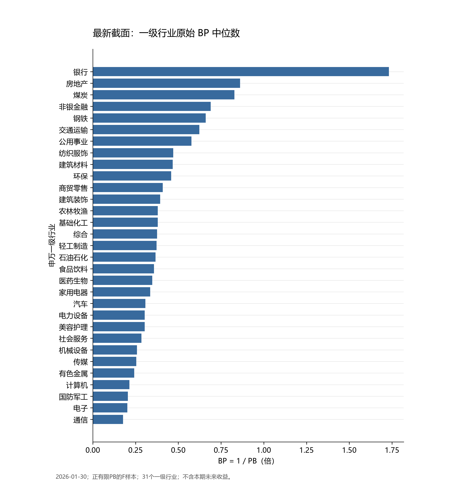

*图A：2026-01-30原始BP行业中位数。底层数据与矢量图见同一运行目录。*

最新截面共5273只F股票、31个一级行业。银行BP中位数为1.732，通信为0.177，前者约为后者的9.8倍。房地产和煤炭也处于较高区间。这种行业差异支持在比较股票之前控制行业；不能把银行高BP本身解释为银行股票具有更高预测收益。综合行业在本截面仅15只，仍展示中位数，但不据此认定其行业分层可靠。

### 3.2 与规模的关系

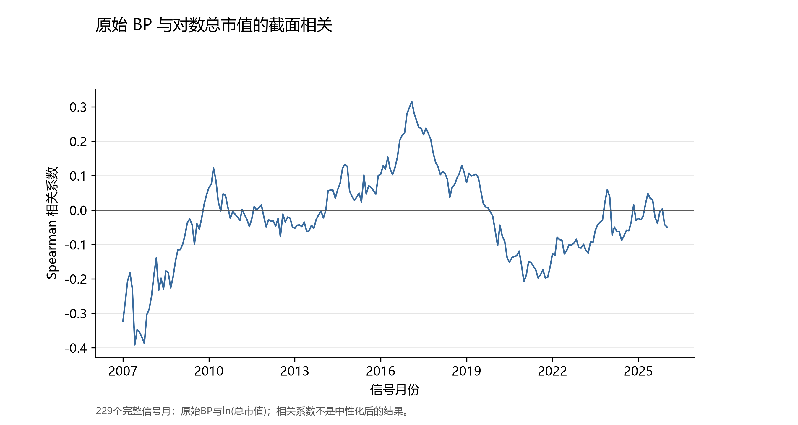

*图B：原始BP与对数总市值逐月Spearman相关。底层数据与矢量图见同一运行目录。*

229/229个信号截面均可计算，相关系数均值为-0.0228；与均值同为负号的月份为136/229（59.39%），正号为93/229。均值较小并不表示每月都与规模无关，图中方向曾发生反转。因此保留逐期规模控制，且不把中性化后的低相关倒写为原始BP无规模关联。

### 3.3 覆盖度

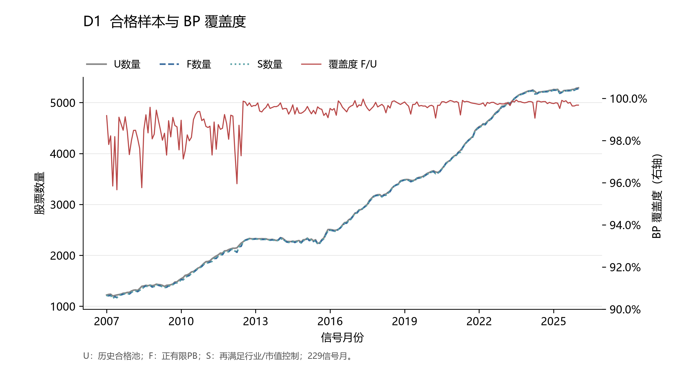

*D1：全A合格池、因子样本与覆盖度。底层数据与矢量图见同一运行目录。*

全A各月F/U介于95.66%与99.97%。最新截面U=5,290、F=S=5,273，覆盖度为99.68%。229期累计U与F之差为3,602个股票—期，其中估值整行缺失2,660、PB字段缺失942、非有限0、零值0、负值0。缺失不能统一解释为负净资产；ST/PT和入场不合格已在U之前过滤，不进入覆盖率分母。覆盖度较高仅支持数据可用性，不等于预测有效性。

## 4. 方法与默认参数

每个交易月末生成信号，下一交易日收盘建仓，持有到下一月末后的首个交易日收盘。个股收益为同一原始代码尺度的“退出复权估值/入场复权估值−1”；端点估值规则见第2节。回归、IC、分层与指数共享日期表。

1. **预处理。** 在各池S中对原始BP作中位数±5×MAD截尾，MAD为绝对离差的中位数。回归暴露再作Z-score（截面标准差ddof=0）。IC与分层使用截尾BP对截距、对数总市值及行业哑变量作OLS后的残差；负残差仍有效。
2. **WLS与IC。** 下期个股收益对标准化BP、对数总市值及行业回归；目标函数权重为流通市值平方根，拟合矩阵相应再乘权重平方根。Rank IC是冻结残差与下期收益的Spearman相关。截面t采用课程常规WLS残差方差，不是稳健标准误；表中t均值不代表因子收益时间序列均值的t检验。
3. **分层与费用。** 按残差从低到高等人数五分层，层内等权；并列时按证券代码稳定排序。教材只数换手为`1−本期与上期持仓交集数/本期只数`，首期为1。各层净收益=毛收益−0.004×换手。多空=Q5毛收益−Q1毛收益−两腿各自成本，不能相减两条净收益。该近似忽略权重漂移、完整再平衡及借券融资，不额外模拟交易撮合。
4. **基准。** 内部基准为当期全部实际分层S的个股等权毛收益，不另扣换手成本；不是五层收益的简单平均。外部沪深300与中证500采用相同端点的价格指数，不含分红。个股复权收益与价格指数并非完全同口径，主要选股比较使用内部基准。
5. **统计。** 连续完整月频净收益的CAGR=`prod(1+r)^(12/n)−1`；夏普=`sqrt(12)×mean(r)/sd(r)`，RF=0；算术年化超额=`12×mean(层净收益−基准毛收益)`；IR将同一月超额均值除以其标准差再乘`sqrt(12)`。时间序列标准差ddof=1，ICIR不年化。最大回撤含期初净值1，以非正数表示；超额回撤用层净值/基准净值计算。
6. **扩展与缺期。** D9在同一全A样本与残差上改十层。C4在行业内五层，D10每月先按流通市值三等分，再在域内按同一全A残差十分层，均不重新中性化。C4每期至少25只，D10每域至少50只，并检查不同因子取值数。无法形成或评价的月份保留为空，不拼接年化、不补零。C4共同窗口在看收益前冻结为2021-07至2025-12信号月；综合行业不足，保留空结果。

主设定在首次绩效计算前已冻结。以下分段解读按持有期归属月使用2007-02—2013-12、2014-01—2020-12、2021-01—2026-01三个连续日历块，目的为描述变化，不构成额外显著性检验或重新择窗。

## 5. 三池主结果

### 5.1 C1：回归与Rank IC

| 股票池 | 绝对t均值 | 绝对t>2（月数/228） | 占比 | t均值 | 因子收益均值/月 |
| --- | --- | --- | --- | --- | --- |
| 全部 A 股 | 4.729 | 160/228 | 70.18% | 1.757 | 0.40% |
| 沪深300 | 2.106 | 101/228 | 44.30% | 0.531 | 0.34% |
| 中证500 | 1.898 | 87/228 | 38.16% | 0.466 | 0.25% |

三池的平均回归系数均为正。全A绝对t均值4.729、绝对t>2共160/228期，但t均值仅1.757；沪深300、中证500的t均值分别为0.531和0.466。绝对t反映偏离零的强度，包含负向月份，不能替代正向稳定性。这些是逐截面统计的描述，不能据此宣布时间序列均值通过了稳健显著性检验。

| 股票池 | Rank IC均值 | 标准差 | ICIR（未年化） | IC>0（月数/228） | 占比 |
| --- | --- | --- | --- | --- | --- |
| 全部 A 股 | 0.0566 | 0.1028 | 0.550 | 162/228 | 71.05% |
| 沪深300 | 0.0366 | 0.1279 | 0.286 | 134/228 | 58.77% |
| 中证500 | 0.0350 | 0.1056 | 0.332 | 145/228 | 63.60% |

全A平均Rank IC为0.0566，正向月份162/228；沪深300与中证500分别为0.0366、0.0350。方向与平均回归系数一致，但指数池的ICIR均低于全A。三池同窗比较排除了时段不同这一解释；成员范围、截面数量与各池独立预处理仍有差异，不能将差距唯一归因于规模。

### 5.2 C2：五层与多空绩效

| 股票池 | Q1年化 | Q2年化 | Q3年化 | Q4年化 | Q5年化 | 递增相邻层/4 | 层序秩相关 |
| --- | --- | --- | --- | --- | --- | --- | --- |
| 全部 A 股 | 4.55% | 8.71% | 14.00% | 17.75% | 20.98% | 4/4 | 1.000 |
| 沪深300 | 2.22% | 3.78% | 3.14% | 7.31% | 10.40% | 3/4 | 0.900 |
| 中证500 | 5.64% | 7.61% | 8.99% | 10.16% | 13.50% | 4/4 | 1.000 |

全A五层年化净收益从4.55%依次升至20.98%，4/4个相邻层递增，层序与年化收益Spearman为1。中证500同样4/4递增；沪深300为3/4，Q3低于Q2。整体排序支持正向BP假说，但“每池严格单调”不成立。

| 股票池 | 多空年化 | 多空夏普 | 多空最大回撤 | 多空月胜率 | Q5算术年化超额 |
| --- | --- | --- | --- | --- | --- |
| 全部 A 股 | 13.00% | 1.150 | -15.66% | 136/228 (59.65%) | 5.31% |
| 沪深300 | 5.28% | 0.470 | -47.50% | 121/228 (53.07%) | 3.41% |
| 中证500 | 5.09% | 0.513 | -22.94% | 121/228 (53.07%) | 2.79% |

全A扣双腿成本后的多空年化为13.00%、夏普1.150、最大回撤-15.66%。两指数池多空年化约5%，且沪深300多空最大回撤接近47.50%，因此全A结果不能直接替代指数池风险判断。全A Q5算术年化超额为5.31%，Q1为-8.92%；多空同时包含高BP端的超额与低BP端的落后，不能全部称为多头选股收益。

### 5.3 时间路径：D2与D3

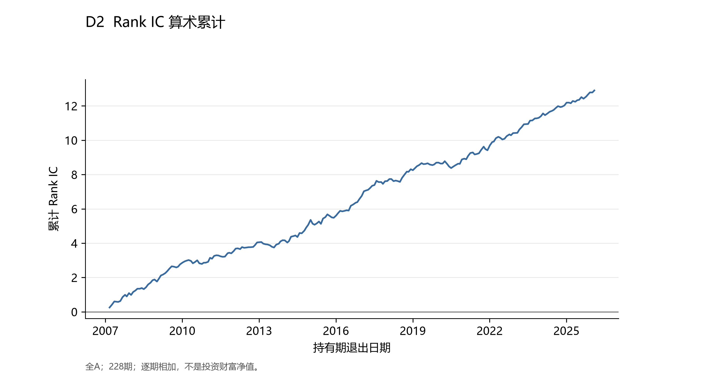

*D2：Rank IC累计和。底层数据与矢量图见同一运行目录。*

三个日历块的平均Rank IC分别为0.0502（2007-02至2013-12，83期）、0.0567（2014-01至2020-12，84期）、0.0652（2021-01至2026-01，61期），均为正；但2010、2013年全年平均IC接近零，累计曲线存在走平阶段。持续累积的是排序相关，不是复利收益。

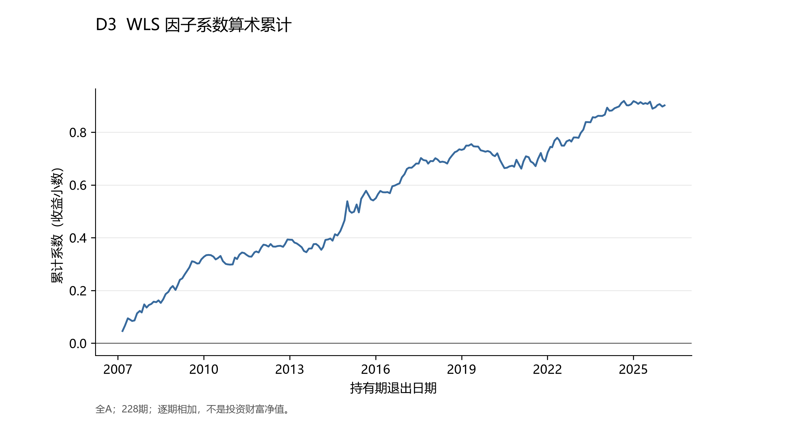

*D3：标准化BP回归系数累计和。底层数据与矢量图见同一运行目录。*

228期回归系数累计为0.9017；三个日历块分别贡献0.3690、0.3073、0.2253，正向累计并非只来自一个块。曲线也存在回落，故正均值不能表述为每月稳定获利。系数对应一单位标准化BP暴露且控制行业和规模，其算术累计没有交易组合净值含义。

### 5.4 绝对、相对与滚动表现：D4–D7

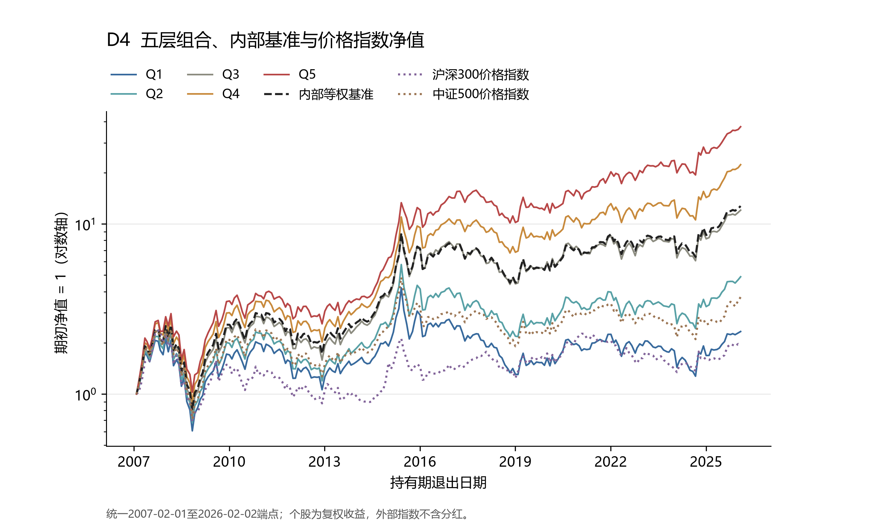

*D4：五层、内部等权基准及两价格指数净值。底层数据与矢量图见同一运行目录。*

同样从1开始，期末Q5净值为37.276，内部基准为12.739，Q1为2.330；沪深300和中证500价格指数分别为1.923与3.712。长期财富差异明显，但Q5最大回撤仍达-65.45%，高年化不等于低绝对风险。图用对数轴呈现比例变化；外部价格指数缺分红且采用市值加权，与个股等权复权组合的差距不能全归于因子。

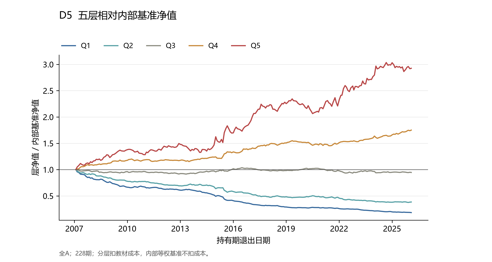

*D5：分层净值除以内部基准净值。底层数据与矢量图见同一运行目录。*

期末Q5/基准为2.926，Q4为1.751，Q3为0.946；超额财富主要集中在高层。但2019-01至2020-12的Q5相对财富变化为-3.35%，这一段没有继续积累优势。相对净值的斜率不等于算术年化超额，分段结论来自对应收益的乘积比。

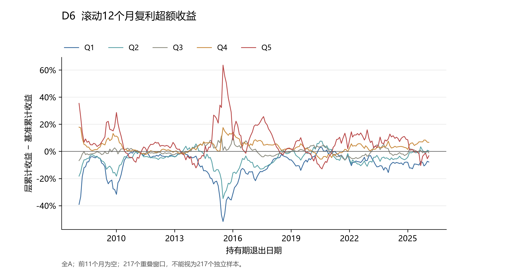

*D6：连续12个月的层复利收益减基准复利收益。底层数据与矢量图见同一运行目录。*

| 持有期归属区间 | 有效滚动点 | Q1均值 | Q2均值 | Q3均值 | Q4均值 | Q5均值 |
| --- | --- | --- | --- | --- | --- | --- |
| 2007-02—2013-12 | 72 | -7.75% | -5.12% | -0.71% | 2.57% | 5.08% |
| 2014-01—2020-12 | 84 | -13.61% | -6.53% | 2.18% | 4.26% | 8.97% |
| 2021-01—2026-01 | 61 | -7.80% | -4.69% | -1.36% | 3.19% | 6.55% |

Q5滚动超额为正的点为161/217，最长连续为负区间为2019-09至2021-01（17个滚动端点，按持有期归属月）。表中Q5三个分段均值为正，不能掩盖这一失效段。前11期为空；每点使用连续12期，且相邻窗口重叠11期，不能按217个独立观测推断显著性。

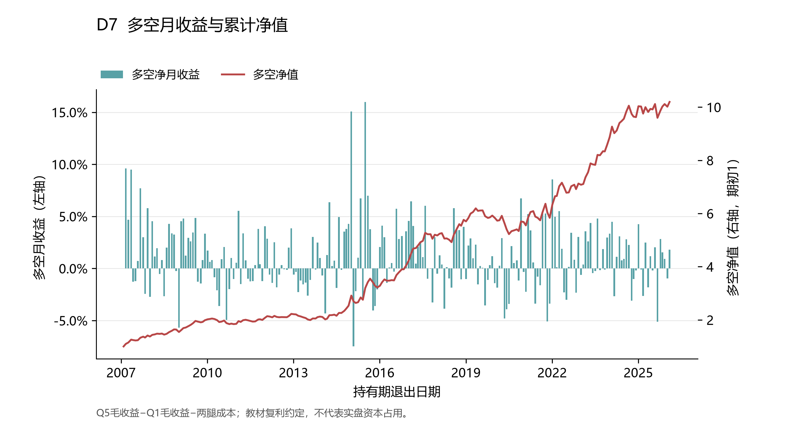

*D7：多空净月收益与同序列复利净值。底层数据与矢量图见同一运行目录。*

多空正收益为136/228个月，期末净值10.197。最差月为2015-01，收益-7.49%；最好月为2015-06，收益15.99%，均按持有期起始月份归属。月度胜率仅约六成，长期复利优势并不意味着多数月份都能显著获利。多空是教材双腿差额复利约定，未模拟借券可得性和资金占用。

## 6. 分年度与适用域

### 6.1 C3：年度结果

| 年份 | 月数 | 多空收益 | 多空月胜率 | Q5收益 | 内部基准 | 多头超额 | 平均IC |
| --- | --- | --- | --- | --- | --- | --- | --- |
| 2007（部分） | 11 | 37.39% | 63.64% | 184.68% | 150.96% | 33.71% | 0.0896 |
| 2008 | 12 | 12.36% | 66.67% | -53.13% | -56.76% | 3.63% | 0.0650 |
| 2009 | 12 | 30.89% | 83.33% | 164.05% | 135.40% | 28.66% | 0.0918 |
| 2010 | 12 | -8.44% | 50.00% | 6.87% | 14.86% | -7.99% | 0.0038 |
| 2011 | 12 | 12.38% | 58.33% | -26.52% | -33.32% | 6.80% | 0.0523 |
| 2012 | 12 | 6.39% | 41.67% | 10.94% | 6.09% | 4.84% | 0.0431 |
| 2013 | 12 | -4.65% | 25.00% | 17.91% | 26.76% | -8.85% | 0.0090 |
| 2014 | 12 | 38.12% | 75.00% | 74.61% | 47.88% | 26.73% | 0.0993 |
| 2015 | 12 | 12.71% | 50.00% | 91.24% | 82.89% | 8.35% | 0.0212 |
| 2016 | 12 | 28.65% | 75.00% | 17.53% | 3.19% | 14.33% | 0.0952 |
| 2017 | 12 | 22.51% | 66.67% | 0.72% | -11.80% | 12.51% | 0.0723 |
| 2018 | 12 | 10.22% | 58.33% | -28.71% | -30.16% | 1.45% | 0.0526 |
| 2019 | 12 | 2.37% | 66.67% | 28.81% | 30.54% | -1.73% | 0.0369 |
| 2020 | 12 | -2.70% | 50.00% | 16.54% | 18.97% | -2.44% | 0.0192 |
| 2021 | 12 | 11.54% | 50.00% | 32.26% | 23.75% | 8.51% | 0.0645 |
| 2022 | 12 | 11.76% | 66.67% | -1.22% | -10.78% | 9.56% | 0.0602 |
| 2023 | 12 | 25.24% | 66.67% | 18.04% | 8.82% | 9.22% | 0.0813 |
| 2024 | 12 | 13.13% | 66.67% | 10.51% | 1.94% | 8.56% | 0.0659 |
| 2025 | 12 | -0.17% | 50.00% | 37.61% | 43.00% | -5.39% | 0.0495 |
| 2026（部分） | 1 | 1.80% | 100.00% | 3.83% | 3.52% | 0.31% | 0.1173 |

2007年仅11期、2026年仅1期，表内均为实际累计而非全年外推。18个完整年度中，多空正收益14/18年，多头超额为正13/18年；多空不利年份为2010、2013、2020、2025。2019年多空为正但Q5跑输内部基准，说明低BP端落后可在多头选股失效时支撑多空。2025年IC均值仍为0.0495，Q5超额却为−5.39个百分点：排序关联的存在不保证最高层当年跑赢基准。

### 6.2 C4：行业内五层

共同信号窗2021-07至2025-12，共54期；实际入场2021-08-02，退出2026-02-02。按Q5算术年化超额降序；夏普对应Q5，IR与超额回撤对应行业内部等权基准。收益排序按各层CAGR从高到低列出，ρ为层序与CAGR的Spearman。

| 一级行业 | 有效期/54 | Q5年化超额 | 夏普 | IR | 超额回撤 | 相对月胜率 | 层收益排序 | ρ |
| --- | --- | --- | --- | --- | --- | --- | --- | --- |
| 家用电器 | 54/54 | 17.93% | 1.164 | 1.556 | -5.48% | 64.81% | Q5>Q3>Q4>Q2>Q1 | 0.900 |
| 美容护理 | 54/54 | 14.39% | 0.562 | 0.665 | -18.96% | 55.56% | Q5>Q4>Q2>Q3>Q1 | 0.900 |
| 电力设备 | 54/54 | 12.72% | 0.767 | 1.418 | -7.80% | 66.67% | Q5>Q4>Q3>Q2>Q1 | 1.000 |
| 食品饮料 | 54/54 | 10.59% | 0.555 | 1.276 | -4.64% | 61.11% | Q5>Q4>Q3>Q2>Q1 | 1.000 |
| 电子 | 54/54 | 10.01% | 0.824 | 1.084 | -7.42% | 57.41% | Q5>Q4>Q3>Q2>Q1 | 1.000 |
| 社会服务 | 54/54 | 9.84% | 0.887 | 0.874 | -8.34% | 61.11% | Q5>Q4>Q3>Q2>Q1 | 1.000 |
| 计算机 | 54/54 | 9.57% | 0.749 | 1.081 | -6.38% | 66.67% | Q5>Q4>Q3>Q1>Q2 | 0.900 |
| 医药生物 | 54/54 | 8.25% | 0.555 | 1.043 | -5.45% | 70.37% | Q5>Q4>Q3>Q2>Q1 | 1.000 |
| 农林牧渔 | 54/54 | 7.58% | 0.585 | 1.016 | -5.13% | 55.56% | Q5>Q4>Q2>Q3>Q1 | 0.900 |
| 纺织服饰 | 54/54 | 7.19% | 0.822 | 0.872 | -6.49% | 57.41% | Q5>Q4>Q2>Q3>Q1 | 0.900 |
| 交通运输 | 54/54 | 7.04% | 0.980 | 0.769 | -8.81% | 50.00% | Q5>Q3>Q4>Q2>Q1 | 0.900 |
| 非银金融 | 54/54 | 6.82% | 0.488 | 1.131 | -4.30% | 66.67% | Q5>Q4>Q2>Q3>Q1 | 0.900 |
| 机械设备 | 54/54 | 6.32% | 0.950 | 0.717 | -7.62% | 64.81% | Q5>Q4>Q3>Q2>Q1 | 1.000 |
| 国防军工 | 54/54 | 6.04% | 0.572 | 0.755 | -5.98% | 59.26% | Q5>Q4>Q3>Q2>Q1 | 1.000 |
| 公用事业 | 54/54 | 5.08% | 0.734 | 0.651 | -6.62% | 50.00% | Q5>Q4>Q3>Q2>Q1 | 1.000 |
| 石油石化 | 54/54 | 4.95% | 0.872 | 0.433 | -16.15% | 53.70% | Q5>Q2>Q3>Q1>Q4 | 0.300 |
| 银行 | 54/54 | 2.72% | 0.709 | 0.369 | -11.39% | 55.56% | Q5>Q3>Q4>Q1>Q2 | 0.800 |
| 环保 | 54/54 | 2.43% | 0.423 | 0.333 | -9.01% | 53.70% | Q5>Q4>Q3>Q2>Q1 | 1.000 |
| 有色金属 | 54/54 | 2.38% | 0.824 | 0.216 | -11.42% | 53.70% | Q3>Q5>Q2>Q4>Q1 | 0.500 |
| 汽车 | 54/54 | 2.07% | 0.798 | 0.191 | -16.61% | 51.85% | Q3>Q5>Q4>Q2>Q1 | 0.700 |
| 通信 | 54/54 | 1.60% | 0.896 | 0.162 | -15.17% | 55.56% | Q5>Q4>Q3>Q1>Q2 | 0.900 |
| 基础化工 | 54/54 | 1.45% | 0.562 | 0.189 | -9.65% | 53.70% | Q4>Q5>Q3>Q2>Q1 | 0.900 |
| 建筑装饰 | 54/54 | 0.80% | 0.645 | 0.072 | -18.77% | 48.15% | Q4>Q3>Q5>Q2>Q1 | 0.700 |
| 轻工制造 | 54/54 | 0.68% | 0.529 | 0.096 | -14.05% | 48.15% | Q4>Q5>Q2>Q3>Q1 | 0.800 |
| 传媒 | 54/54 | 0.52% | 0.765 | 0.038 | -16.68% | 53.70% | Q4>Q5>Q2>Q3>Q1 | 0.800 |
| 煤炭 | 54/54 | -0.09% | 0.527 | -0.006 | -24.71% | 48.15% | Q1>Q4>Q5>Q2>Q3 | -0.200 |
| 建筑材料 | 54/54 | -1.53% | 0.354 | -0.141 | -25.57% | 46.30% | Q4>Q3>Q5>Q1>Q2 | 0.600 |
| 商贸零售 | 54/54 | -4.69% | 0.440 | -0.626 | -17.40% | 42.59% | Q3>Q4>Q2>Q5>Q1 | 0.300 |
| 房地产 | 54/54 | -6.39% | 0.105 | -0.586 | -40.77% | 33.33% | Q3>Q4>Q2>Q1>Q5 | -0.100 |
| 钢铁 | 54/54 | -6.75% | 0.010 | -0.749 | -28.33% | 37.04% | Q3>Q4>Q1>Q5>Q2 | 0.100 |
| 综合 | 12/54 | — | — | — | — | — | 样本不足 | — |

30个可比行业中，Q5年化超额为正25/30，Q5收益排名第一19/30、前二24/30。家用电器Q5年化超额17.93%，房地产−6.39%、钢铁−6.75%，煤炭接近零且为负。这支持较广但非普遍的行业内区分能力；美容护理最低只有27只，极端结果尤其不宜外推。综合行业仅12/54期达25只门槛，保留不足行，不拼接12期年化。行业排名是未作多重检验校正的描述，不能据最高排名宣称最优投资行业。

### 6.3 D8与D9：分层粒度及风险调整

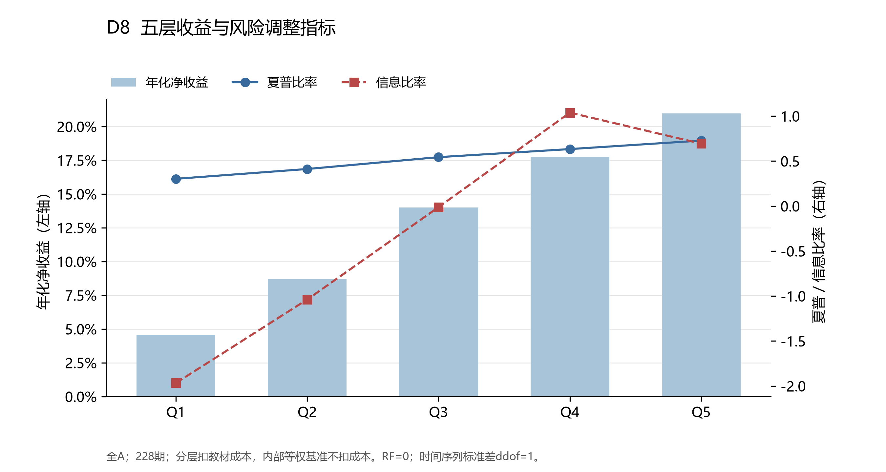

*D8：五层年化收益、夏普与信息比率。底层数据与矢量图见同一运行目录。*

五层年化收益与夏普均随层序递增，Q5夏普为0.727。信息比率却在Q4达到1.038，高于Q5的0.693；Q5相对月胜率53.07%也低于Q4的60.09%。高BP端的绝对收益较高，但相对基准超额的稳定性并非最高；这与“因子越高越稳”不同。

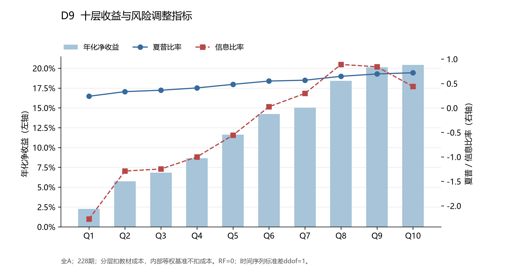

*D9：同一全A残差的十层绩效。底层数据与矢量图见同一运行目录。*

十层CAGR有9/9对相邻层递增，层序秩相关1.000；Q9与Q10分别为20.12%、20.43%，最高尾部增益很小。Q10算术年化超额4.66%低于Q9的4.92%，IR也从0.843降至0.439。更细分层没有逆转整体CAGR排序，却揭示最高尾部的超额波动，不能据五层单调就断言极端BP越大越好。

### 6.4 D10：市值三分域

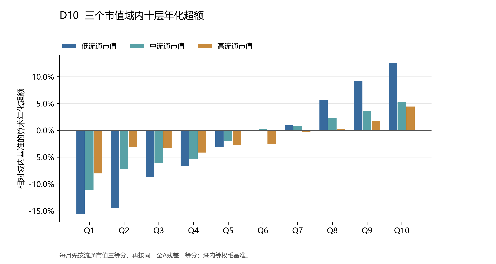

*D10：低、中、高流通市值域内十层年化超额。底层数据与矢量图见同一运行目录。*

| 流通市值域 | 每期只数范围 | Q1年化超额 | Q10年化超额 | 递增相邻层/9 |
| --- | --- | --- | --- | --- |
| 低 | 384—1755 | -15.64% | 12.54% | 9/9 |
| 中 | 383—1755 | -11.08% | 5.31% | 9/9 |
| 高 | 384—1755 | -8.03% | 4.44% | 7/9 |

三域均有228期，Q10算术年化超额分别为12.54%、5.31%、4.44%；低、中市值域的十层年化超额均9/9递增，高市值域有中低层倒序。BP作用在低市值域更强，但高市值域Q10仍为正，不能称其仅适用于小盘。划域发生在S形成之后，域内BP覆盖均为100%；这不替代U→F的整体覆盖，前置排除已在D1披露。市值分界按每月等人数变化，记录实际边界和层数；本图为依次分组，不是独立双重排序，也不保证每层持仓权重严格行业/规模中性。

## 7. 综合判断与局限

**结论为“保留BP作为后续多因子研究候选，同时观察时变性和适用域”。** 三池回归系数和平均Rank IC方向一致，成本后分层大体支持正向假说；全A证据强于两个指数池。年度和行业结果说明它具有条件性：2019、2025年的高层超额不支持持续增强，房地产、钢铁等行业的高层也未跑赢各自基准。上述异质性已经进入判断，没有通过换因子、反转方向或调整窗口消除。

三类证据衡量的对象不同。WLS强调加权线性斜率，Rank IC衡量全截面排序，等权高层组合只使用尾部股票并扣费。因此正IC、正回归与某年Q5弱超额可以同时成立；D8、D9的高层IR回落也提示“高期望收益”与“低超额波动”不可混同。方法检查已统一日期、样本、冻结暴露与成本，剩余差异不应仅用故事强行解释为同一种经济机制。

历史PB及行业来自当前可取得的历史版本，无法证明完全无回填或修订；这限制“当时即可复制”的主张。有限股本修正没有扩展为全市场PIT数据库。停牌和合并估值、两项未上市权利延续以及最后交易日退出依赖已声明政策，限制净值的可执行解释。教材只数换手未计入真实冲击、涨跌停成交、融资融券和投资者税负；Q5与未扣费内部基准的成本待遇也不同。外部价格指数仅作背景参照。

本报告没有完成多空均值的HAC显著性检验、行业多重检验校正或样本外策略评估；逐月t和ICIR不能替代这些推断。没有把这些范围外工作包装成已完成的稳健性。若下一步进入多因子合成，首先应检验BP与其他估值/质量因子的相关冗余，并用新的时间窗及可执行成本验证是否保留增量，而不是根据本次最优行业或市值域直接优化交易规则。

## 8. 复现与资料

本报告唯一实证运行是`bp-v05-20261026-main`，方法版本0.5，研究源码提交`38a536935e4040373d3dde5ad22b4c05cdb0eaee`。月度结果、C1–C4、D1–D10底层数据和12张PNG/PDF/SVG图均位于`outputs/runs/bp-v05-20261026-main/`；逐条主张对应`report/claim_evidence.csv`。证券级暴露、持仓和补充证据保留本地，不随公开仓库提交。

在项目目录，用课程Python环境执行：

```powershell
python -m unittest discover -s tests -p test_bp_core.py -v
python scripts/run_research.py --run-id <新的运行标识> --course-root <课程材料目录>
python scripts/plot_results.py --run-id <同一运行标识>
python scripts/build_report.py --run-id <同一运行标识>
```

`run_research.py`要求P1修复面板及日期表已存在；P1重建入口和资料来源见`outputs/preflight_repaired/preflight_findings.md`及`scripts/preflight_repaired.py`。原始数据仅从课程材料`data/offline`读取。没有找到课程中所称的独立报告生成脚本，故本项目增加了最小报告层，未覆盖课程Notebook或共享qfbook。

方法依据：课程`main_student.pdf`附录书197–200页（PDF211–214页）；交易时点、成本与统计定义参考书177–183页（PDF191–197页）。实现复用`qfbook.factor.single_test`的MAD、标准化、中性化、设计矩阵和双腿扣费；必要行为差异见`outputs/validation/implementation_notes.md`。数据来源核验和官方公告证据见P1预检记录。本文没有引入未经核实的外部论文或文献结论。

本稿由研究代码生成表图，并由AI辅助整理文字与证据对应；不是期刊投稿稿，也未代替作者作课程提交。
